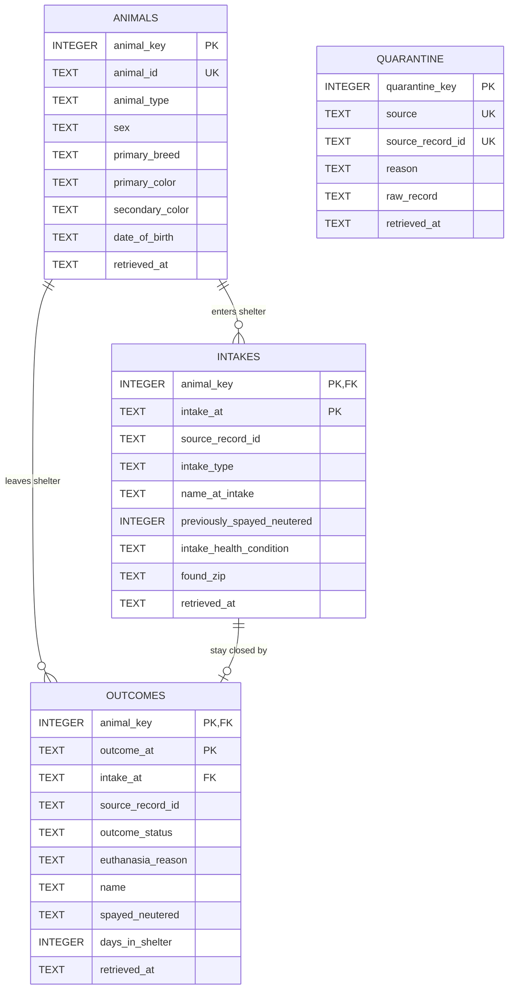

# Austin Animal Center — Ingestion Pipeline & Repository

## 1. Project Title
**Predicting Animal Shelter Length of Stay and Outcome Status (Austin Animal Center Pipeline)**

## 2. The Question (Project Intent)
This data lets us explain and predict how an animal's species, breed, sex, spay/neuter status, age (from date of birth) and intake source affect how long it stays in the shelter and how it leaves (adoption, transfer, return to owner, euthanasia). We will build a regression model for length of stay and a classification model for the outcome type. Monthly intake volume shows a clear seasonal pattern, so we will also examine seasonal effects. The results can help a shelter decide which animal profiles need earlier and stronger promotion.

## 3. Data Sources
- **Austin Animal Center Intakes**: Live intake events from the City of Austin Open Data Portal. Detailed provenance and field definitions: [docs/sources.md#1-austin-animal-center-intakes](docs/sources.md#1-austin-animal-center-intakes).
- **Austin Animal Center Outcomes**: Live outcome exits from the City of Austin Open Data Portal. Detailed provenance and field definitions: [docs/sources.md#2-austin-animal-center-outcomes](docs/sources.md#2-austin-animal-center-outcomes).
- *Attribution*: Public datasets published by the City of Austin Open Data Portal (data.austintexas.gov) under Public Domain / City of Austin Open Data Terms of Use.

## 4. How to Run It
Follow these steps from a fresh clone:

1. **Clone the repository:**
   ```bash
   git clone https://github.com/osmankalkan/austin-animal-outcomes.git
   cd austin-animal-outcomes
   ```

2. **Create and activate a virtual environment:**
   ```bash
   python3 -m venv .venv
   source .venv/bin/activate  # On Windows: .venv\Scripts\activate
   ```

3. **Install dependencies:**
   ```bash
   pip install -r requirements.txt
   ```

4. **Configure environment variables:**
   ```bash
   cp .env.example .env
   # Optionally edit .env to provide your AUSTIN_APP_TOKEN
   ```

5. **Run the ingestion script (M1 — land raw data):**
   ```bash
   python src/ingest.py
   ```
   The script retrieves both Intakes and Outcomes, lands unmodified raw JSON files under `data/raw/<source>/<TIMESTAMP>.json`, and prints a run health summary.

6. **Build the database (M2 — load raw files into SQLite):**
   ```bash
   python src/load.py
   ```
   Reads only the landed files in `data/raw/` (never the API), creates `data/austin_animals.db` from scratch if it does not exist, and prints a run summary. Running it again changes nothing (`+0 new this run`).

7. **Run the checks (M2):**
   ```bash
   python src/checks.py
   ```
   Runs six checks against a temporary copy of the database and prints `PASS`/`FAIL` for each.

8. **Run the analytical query (optional):**
   ```bash
   sqlite3 data/austin_animals.db < sql/queries/length_of_stay_by_animal_type.sql
   ```

## 5. Repository Structure
```text
austin-animal-outcomes/
├── README.md               # Project documentation and execution instructions
├── .gitignore              # Ignores secrets (.env), virtualenvs, raw data dumps and the database
├── .env.example            # Template for environment configuration & API credentials
├── requirements.txt        # Exact Python dependencies
├── data/
│   ├── austin_animals.db   # Built by src/load.py (not committed)
│   └── raw/                # Landed raw JSON responses (organized by source, timestamped)
│       ├── intakes/        # Raw intake snapshots
│       └── outcomes/       # Raw outcome snapshots
├── sql/
│   ├── schema.sql          # STRICT SQLite schema (re-runnable)
│   └── queries/
│       └── length_of_stay_by_animal_type.sql
├── src/
│   ├── client.py           # Robust SODA API client (retry backoff, timeouts, pagination)
│   ├── storage.py          # UTC timestamped raw file landing mechanism
│   ├── ingest.py           # Single-command CLI runner and run summary reporter
│   ├── db.py               # connect() (foreign keys ON) and shared helpers
│   ├── transform.py        # Type / timestamp validation and normalisation
│   ├── load.py             # Raw files -> SQLite loader (idempotent, atomic, parameterised)
│   └── checks.py           # Six schema/loader checks on a temporary database copy
└── docs/
    └── sources.md          # Comprehensive Data Source provenance cards
```

## 6. Data Model

### 6.1 ER diagram



All tables are `STRICT`. `outcomes (animal_key, intake_at)` is a composite foreign key to `intakes (animal_key, intake_at)`: every outcome closes one known stay. `quarantine` has no foreign keys on purpose — it holds records whose references could not be resolved.

### 6.2 Grain of every table
- **animals** — one row is one animal known to the shelter (identified by the provider's `animal_id`), with its latest retrieved attributes.
- **intakes** — one row is one arrival of one animal at the shelter at one moment (`animal_key`, `intake_at`).
- **outcomes** — one row is one exit of one animal from the shelter at one moment (`animal_key`, `outcome_at`), linked to the intake it closes.
- **quarantine** — one row is one raw record (per source and provider `id`) that could not be loaded yet, kept verbatim with the reason.

### 6.3 Decisions and findings

**Keys.**
- *Animal:* `animal_id` from the provider, kept as `NOT NULL UNIQUE`; `animal_key` is our surrogate `INTEGER PRIMARY KEY`.
- *Intake event:* `(animal_key, intake_at)`. *Outcome event:* `(animal_key, outcome_at)`. All key columns are `NOT NULL`.
- *What we tested on the landed raw data (after removing re-fetched copies):*
  - `id` is unique in both sources (0 duplicates).
  - `(animal_id, source_date)` and `(animal_id, outcome_date)` are unique (0 duplicates), so they work as event keys.
  - Attributes that should never change per animal — `type`, `primary_breed`, `date_of_birth` — have exactly one value per `animal_id` (`groupby(...).nunique()` = 1 for all animals).
  - 644 animals have more than one intake (returns / re-admissions), which is why the intake key includes the timestamp.
  - Two intake snapshots overlap almost completely: 18,426 re-fetched copies were collapsed by key; the most recent `retrieved_at` won.

**Missing values.**
- A missing field in the API (`null` or key absent) means *not recorded*, never zero. It is stored as `NULL`. Examples: `date_of_birth` is missing for 1,561 animals, `secondary_color` and `intake_health_condition` are often absent.
- Values that do not fit their column are converted to `NULL` and counted in the run summary as `values cleaned`: non-numeric or negative `days_in_shelter`, unparseable `date_of_birth`, non-boolean spay/neuter flags. On the current data the count is **0**: `days_in_shelter` arrives as text (`"733"`), but every value parses as an integer.
- **Timestamps:** the portal sends Austin local wall-clock time without an offset (`2025-05-04T20:45:00.000`). The loader explicitly converts it from `America/Chicago` (DST-aware) to UTC: `2025-05-05T01:45:00Z`. `date_of_birth` is a calendar date and is stored as `YYYY-MM-DD` without conversion.
- `found_address` is free text with street-level addresses. Only the 5-digit ZIP code is stored (`found_zip`), so the database holds no street-level personal data.

**Unknown references.**
An outcome whose animal or intake we do not have is sent to `quarantine` with its reason. It is never dropped and never makes the load crash. On the next run it is re-checked; if its intake has arrived it is loaded and removed from quarantine.
- `unknown_animal` — **1,008** outcomes: these animals entered the shelter before the May 2025 system cutover (their `days_in_shelter` reaches 1,641), so the live intake dataset never contains them.
- `intake_not_found` — **80** outcomes: the animal exists, but the outcome's `intake_date` matches none of its intakes. Most point to a stay that started before May 2025 (e.g. `intake_date` 2025-04-01 with midnight time); a few differ by minutes from the recorded intake.
- We chose quarantine over loading these outcomes with a NULL intake: a length-of-stay analysis needs the exact stay an outcome closes, and the composite foreign key guarantees it.

**Bad records and atomicity.**
- A landed file that is not valid JSON, is not a list, or contains a non-object record makes the whole run fail before anything is committed. The database stays exactly as it was (`STATUS: FAILED`, transaction rolled back).
- A bad *value* inside a valid record is handled at row level instead:
  - a broken key or timestamp sends the record to `quarantine`;
  - a non-numeric number or an unparseable date becomes `NULL` and is counted.
- All writes of a run (animals, intakes, outcomes, quarantine) happen in one transaction (`with con:`). If any step fails, none of them land. `src/checks.py` proves this by forcing a failure after animals and intakes were already written.

**Change over time.**
- Animal attributes do not change in the current data, but `sex` can (e.g. `Unknown` at intake, known later).
- `animals` is **type 1**: the latest retrieved version overwrites the row (`ON CONFLICT (animal_id) DO UPDATE ... WHERE excluded.retrieved_at >= animals.retrieved_at`), and the surrogate key never changes.
- Spay/neuter status is stored on the events (`intakes.previously_spayed_neutered`, `outcomes.spayed_neutered`), not on the animal, because it legitimately changes during a stay.

**Known issues (left for M3).**
- 1 outcome has `outcome_at` earlier than its `intake_at`.
- `animal_type` mixes life stage and species (`Kitten` vs `Cat`, `Puppy` vs `Dog`).
- `outcome_status` has many fine-grained variants (`Adopted`, `Adopted Altered`, `Adopted Offsite(Altered)`).
- `sex` uses `Unknown` as a value besides real `NULL`s.
- Names starting with `*` are shelter-assigned names.
- 1,179 intakes have no outcome yet: these animals are still in the shelter (open stays, right-censored for length-of-stay analysis).
- The event key assumes the provider does not edit an event's timestamp. If it did, the edited event would appear as a new row next to the old one.

### 6.4 Analytical query

[`sql/queries/length_of_stay_by_animal_type.sql`](sql/queries/length_of_stay_by_animal_type.sql) — *For each animal type, how long does a completed stay last and what share ends in adoption?*

```sql
-- Result grain: one row per animal_type.
-- Each outcomes row is one completed stay: it closes exactly one intake
-- (composite FK on animal_key + intake_at), and the join to animals is
-- many-to-one, so no row is duplicated and every stay is counted once.
SELECT
    a.animal_type,
    COUNT(*)                                                           AS completed_stays,
    ROUND(AVG(julianday(o.outcome_at) - julianday(o.intake_at)), 1)    AS avg_stay_days,
    ROUND(100.0 * AVG(CASE WHEN o.outcome_status LIKE 'Adopted%' THEN 1 ELSE 0 END), 1)
                                                                       AS adoption_rate_pct
FROM outcomes AS o
JOIN animals  AS a ON a.animal_key = o.animal_key
GROUP BY a.animal_type
HAVING COUNT(*) >= 30
ORDER BY completed_stays DESC;
```

| animal_type | completed_stays | avg_stay_days | adoption_rate_pct |
|---|---:|---:|---:|
| Cat | 8,424 | 20.9 | 57.3 |
| Dog | 5,993 | 29.8 | 52.5 |
| Kitten | 1,612 | 9.3 | 24.5 |
| Mammal | 680 | 32.1 | 0.0 |
| Puppy | 311 | 8.9 | 32.8 |
| Rabbit | 72 | 27.3 | 68.1 |
| Guinea Pig | 47 | 22.3 | 19.1 |

*Reading:* dogs stay about 9 days longer than cats on average. Kittens and puppies leave fastest but are rarely recorded as "Adopted": many leave as transfers to partner organisations, which motivates the outcome-type model.

### 6.5 How to build the database
From a fresh clone with landed raw data in `data/raw/` (steps 1–5 above):

```bash
pip install -r requirements.txt
python src/load.py      # builds data/austin_animals.db from data/raw/
python src/load.py      # second run: same state, +0 new rows
python src/checks.py    # six checks on a temporary copy: all PASS
```

The database file is derived and is not committed (`data/*.db` is in `.gitignore`); anyone with the raw files can rebuild it with `python src/load.py`.

## 7. Status
M2 — schema and load complete.

## 8. Team
- Ferdi Derebaşı (Student ID: 230717056) — GitHub: [@Ferdi-krbk](https://github.com/Ferdi-krbk)
- Irmak Köse (Student ID: 230717027) — GitHub: [@irmak23](https://github.com/irmak23)
- Osman Kalkan (Student ID: 230717048) — GitHub: [@osmankalkan](https://github.com/osmankalkan)
