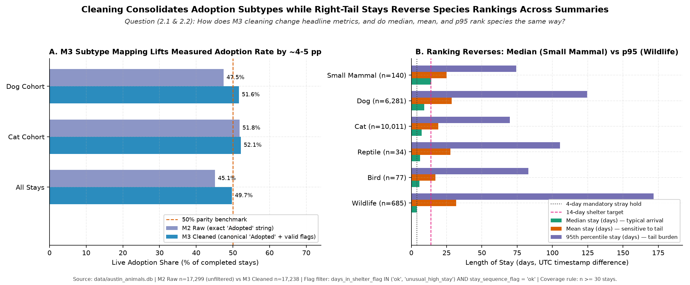
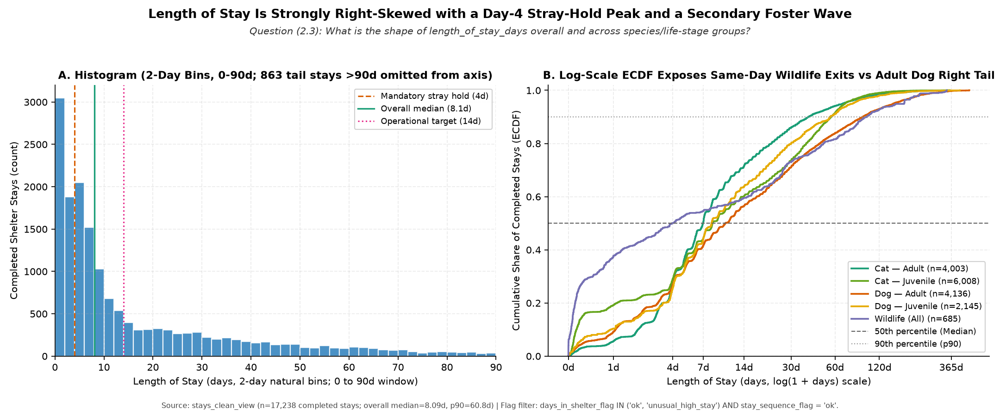
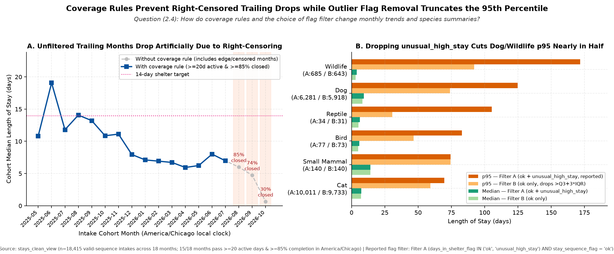
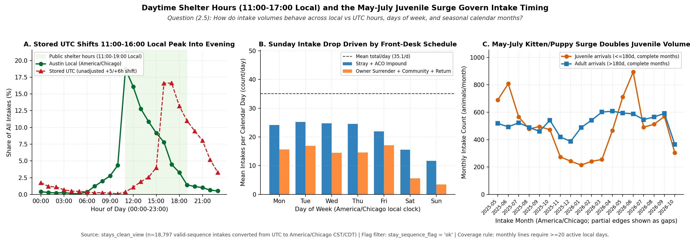

# Exploratory Analysis — Austin Animal Center Shelter Intakes & Outcomes

## 1. Summary

We asked how an animal's canonical species, life stage (`juvenile` vs. `adult`), intake channel, and reproductive status relate to shelter length of stay (`length_of_stay_days`) and live adoption probability (`outcome_status = 'Adopted'`) across `17,238` valid completed stays at the Austin Animal Center. Exploration shows that typical stay duration is governed by a right-skewed multi-stage distribution (`Cat` median `7.30` days, `IQR = 21.45`d; `Dog` median `9.19` days, `IQR = 27.19`d), where group rankings reverse depending on whether we measure the typical arrival via the median (`Small Mammal` longest at `14.12`d, `Wildlife` shortest at `3.95`d) or long-term kennel capacity burden via the 95th percentile (`Wildlife` `171.7`d and `Dog` `124.7`d longest). Most importantly, comparing pooled `Dog` versus `Cat` adoption rates (`51.6%` vs. `52.1%`, difference `-0.52` percentage points) masks a strong **Simpson's paradox** driven by group composition: `60.1%` of Cat stays are high-adoption juveniles (`<= 180` days old) and `40.4%` enter through the `Community Program` trap-neuter-return pathway, whereas within **Adult stays (`> 180` days)** Dogs achieve a `+5.41` percentage point higher live adoption rate than Cats (`49.1%` vs. `43.7%`, 95% daily-cohort cluster bootstrap CI `[+2.88, +8.03]`) while staying `+3.28` days longer at the median (`10.26`d vs. `6.98`d). Among adopted companion animals, age at intake exhibits a strong negative rank correlation with length of stay in juvenile cats (Spearman $\rho = -0.46$, driven by unweaned neonates `< 42` days waiting in foster care until reaching the 8-week surgical spay/neuter threshold) that flattens in adults and flips pooled Pearson correlation positive ($r = +0.08$) due to long-stay adult dogs. We are confident in the compositional and mechanical drivers within our 17-month observation window, but seasonal conclusions remain exploratory because a multi-year baseline and resolution of the `1,179+` right-censored open stays could shift tail quantiles in late-summer cohorts. **M3 issues fixed since the M3 tag:** During Section 2.5 time-edge checks, we identified Issue `I-13` (a static `MAX_VALID_DATE = '2026-10-08'` ceiling in `src/clean_config.py` that flagged valid late-October neonates as `invalid_future_date` when newer snapshots were loaded) and fixed `src/clean.py`, `src/validate.py`, and `docs/cleaning_report.md` to anchor future-date validation dynamically to `max(MAX_VALID_DATE, retrieved_at[:10])` and freshness checks to `MAX(substr(intake_at, 1, 10))`.

---

## 2. Raw versus cleaned

To quantify how Milestone M3 cleaning changed the headline numbers behind our project question, we executed both the raw M2 aggregation (`outcomes` joined to `animals`, unfiltered) and the M3 cleaned aggregation (`stays_clean_view` filtered to valid primary stays `days_in_shelter_flag IN ('ok', 'unusual_high_stay') AND stay_sequence_flag = 'ok'`). Both queries are stored in [`sql/queries/m4_raw_vs_cleaned_key_metrics.sql`](../sql/queries/m4_raw_vs_cleaned_key_metrics.sql):

```sql
-- Query 1: M2 Raw tables (unfiltered outcomes joined to animals)
SELECT
    a.animal_type AS raw_species,
    COUNT(*) AS n_completed_stays,
    ROUND(AVG(julianday(o.outcome_at) - julianday(o.intake_at)), 2) AS mean_los_days,
    ROUND(100.0 * AVG(CASE WHEN o.outcome_status = 'Adopted' THEN 1.0 ELSE 0.0 END), 2) AS adopted_exact_pct,
    ROUND(100.0 * AVG(CASE WHEN o.outcome_status LIKE 'Adopted%' THEN 1.0 ELSE 0.0 END), 2) AS adopted_like_pct
FROM outcomes AS o
JOIN animals  AS a ON a.animal_key = o.animal_key
GROUP BY a.animal_type;

-- Query 2: M3 Cleaned layer (stays_clean_view with reported flag filter)
SELECT
    s.animal_type AS clean_species,
    COUNT(*) AS n_completed_stays,
    ROUND(AVG(s.length_of_stay_days), 2) AS mean_los_days,
    ROUND(100.0 * AVG(CASE WHEN s.outcome_status = 'Adopted' THEN 1.0 ELSE 0.0 END), 2) AS adopted_canonical_pct
FROM stays_clean_view AS s
WHERE s.outcome_at IS NOT NULL
  AND s.days_in_shelter_flag IN ('ok', 'unusual_high_stay')
  AND s.stay_sequence_flag = 'ok'
GROUP BY s.animal_type;
```

| cohort | layer | n | median_los_d | iqr_los_d | mean_los_d | p90_los_d | p95_los_d | adopted_exact_pct | adopted_all_subtypes_pct |
| --- | --- | --- | --- | --- | --- | --- | --- | --- | --- |
| M2 Raw — All Outcomes (unfiltered) | M2 Raw | 17299 | 8.08 | 24.18 | 23.12 | 60.82 | 90.03 | 45.11 | 49.6 |
| M3 Cleaned — All Valid Completed Stays | M3 Cleaned | 17238 | 8.09 | 24.21 | 23.13 | 60.82 | 90.03 | 49.73 | 49.73 |
| M2 Raw — 'Cat' (excludes raw 'Kitten') | M2 Raw | 8424 | 8.76 | 24.23 | 20.86 | 55.92 | 72.98 | 51.8 | 57.34 |
| M2 Raw — 'Kitten' (separate raw type) | M2 Raw | 1612 | 4.08 | 7.96 | 9.35 | 29.27 | 45.44 | 24.26 | 24.5 |
| M3 Cleaned — Canonical 'Cat' (Adult + Juvenile) | M3 Cleaned | 10011 | 7.3 | 21.45 | 19.04 | 52.22 | 69.8 | 52.15 | 52.15 |
| M2 Raw — 'Dog' (excludes raw 'Puppy') | M2 Raw | 5993 | 10.04 | 28.99 | 29.79 | 79.98 | 127.43 | 47.46 | 52.48 |
| M2 Raw — 'Puppy' (separate raw type) | M2 Raw | 311 | 5.04 | 5.93 | 8.91 | 19.22 | 28.62 | 32.8 | 32.8 |
| M3 Cleaned — Canonical 'Dog' (Adult + Juvenile) | M3 Cleaned | 6281 | 9.19 | 27.19 | 28.74 | 77.22 | 124.7 | 51.63 | 51.63 |

**Explanation of differences:** Across all completed stays, matching exact `outcome_status = 'Adopted'` on M2 raw tables yields an adoption share of only `45.11%` (`n = 17,299`), whereas the M3 cleaned layer reports `49.73%` (`n = 17,238`) because M3 maps six operational adoption subtypes (`'Adopted Altered'`, `'Adopted Offsite(Altered)'`, `'Adopted Unaltered'`, `'Adopted Offsite'`, `'Adopted Offsite(Unaltered)'`, and `'Adopted to Finder'`) into canonical `'Adopted'` while removing secondary duplicate exit rows (`duplicate_exit_for_stay`), negative-duration timestamps (`invalid_outcome_before_intake`), and sequence overlaps (`stay_sequence_flag != 'ok'`). At the species level, raw M2 separated `'Kitten'` (`n = 1,612`, mean stay `9.35`d, exact adoption `24.26%` because most kittens exit via partner rescue transfers or altered adoption subtypes) from `'Cat'` (`n = 8,424`, mean stay `20.86`d). Merging `'Kitten'` and `'Puppy'` into canonical `'Cat'` (`n = 10,011`, median `7.30`d, mean `19.04`d) and `'Dog'` (`n = 6,281`, median `9.19`d, mean `28.74`d) while tracking `life_stage` separately prevents taxonomic dilution and reveals the true species and age baselines.



---

## 3. The question and its summary

**Project Question:** *How do an animal's canonical species, life stage (`juvenile` vs. `adult`), intake channel, and reproductive status relate to how long it stays at the Austin Animal Center (`length_of_stay_days`) and whether its stay ends in live adoption (`outcome_status = 'Adopted'`)?*

**Chosen Summary and Justification:** For shelter length of stay (`length_of_stay_days`), we report the **median (`p50`) paired with the interquartile range (`IQR = Q3 - Q1`)** as our primary location-and-spread summary, supplemented by the **95th percentile (`p95`)** for tail capacity and the **live adoption share (%)** for exit disposition. As established in Lecture 1.3, the arithmetic mean is an unrepresentative summary of a typical animal's stay when the distribution is bounded below at zero (`0.0` days) and possesses a heavy right tail stretching to `484` days: a small fraction (~`3.9%`–`4.3%`) of animals held for medical rehabilitation, ringworm quarantine, or cruelty-case court holds pulls the mean to more than double or triple the median (`Cat` mean `19.04`d vs. median `7.30`d; `Dog` mean `28.74`d vs. median `9.19`d).

| animal_type | n | passes_coverage_rule | median_d | iqr_d | mean_d | sd_d | p90_d | p95_d | share_gt_14d_pct | share_gt_30d_pct | adoption_rate_pct | rank_by_median | rank_by_mean | rank_by_p95 |
| --- | --- | --- | --- | --- | --- | --- | --- | --- | --- | --- | --- | --- | --- | --- |
| Cat | 10011 | True | 7.3 | 21.45 | 19.04 | 27.95 | 52.22 | 69.8 | 35.3 | 21.5 | 52.2 | 3.0 | 5.0 | 6.0 |
| Dog | 6281 | True | 9.19 | 27.19 | 28.74 | 49.3 | 77.22 | 124.7 | 41.0 | 25.9 | 51.6 | 2.0 | 2.0 | 2.0 |
| Wildlife | 685 | True | 3.95 | 34.98 | 31.75 | 56.69 | 97.78 | 171.72 | 40.4 | 27.0 | 0.0 | 6.0 | 1.0 | 1.0 |
| Small Mammal | 140 | True | 14.12 | 35.28 | 24.96 | 26.24 | 54.07 | 74.42 | 50.7 | 32.1 | 52.1 | 1.0 | 4.0 | 5.0 |
| Bird | 77 | True | 5.8 | 21.48 | 17.07 | 26.64 | 46.58 | 82.89 | 35.1 | 16.9 | 23.4 | 5.0 | 6.0 | 4.0 |
| Reptile | 34 | True | 6.2 | 20.9 | 27.69 | 75.45 | 42.83 | 105.39 | 29.4 | 14.7 | 35.3 | 4.0 | 3.0 | 3.0 |
| Other | 6 | False | 5.45 | 2.58 | 7.88 | 5.4 | 13.32 | 15.97 | 16.7 | 0.0 | 83.3 | nan | nan | nan |
| Livestock | 4 | False | 5.17 | 5.1 | 8.46 | 7.23 | 15.29 | 17.26 | 25.0 | 0.0 | 25.0 | nan | nan | nan |

**Comparison with Alternative Summaries (Ranking Reversal Finding):** Computing the arithmetic mean, 90th percentile (`p90`), 95th percentile (`p95`), and share of stays exceeding 30 days (`share_gt_30d_pct`) on the exact same variable demonstrates that **different summaries do not rank the species groups the same way** (Figure 1, Panel B):
- **By the Median (`rank_by_median`):** Among the 6 species meeting our coverage rule (`n >= 30`), `Small Mammal` ranks **#1 longest** (`14.12` days, `n = 140`), followed by `Dog` (`#2`, `9.19`d, `n = 6,281`), `Cat` (`#3`, `7.30`d, `n = 10,011`), `Reptile` (`#4`, `n = 34`), `Bird` (`#5`, `n = 77`), and `Wildlife` ranks **#6 shortest** (`3.95`d, `n = 685`). This ranking answers the operational question: *"How long does a typical arrival wait before exiting the shelter?"*
- **By the Mean (`rank_by_mean`) and 95th Percentile (`rank_by_p95`):** The ranking **completely inverts** for `Wildlife` and `Small Mammal`! `Wildlife` jumps from **#6 (shortest median, `3.95`d)** to **#1 longest by both mean (`31.75`d) and 95th percentile (`171.72`d)**, and `Dog` rises to **#2 (`mean = 28.74`d, `p95 = 124.70`d)**, while `Small Mammal` drops to `#3`/`#4` (`p95 = 74.42`d). Why? While over half of wildlife arrivals exit within 0–3 days via immediate transfer to wildlife rehabilitators or humane euthanasia for rabies/trauma, a distinct sub-cohort of overwintering bats and rehabilitating raccoons stays `120–340` days. Thus, the median answers what happens to the *typical individual*, whereas `p95` and the mean answer *"Which group generates the heaviest long-tail residency load on shelter cages and foster homes?"*

---

## 4. What the data is made of

### 4.1 Distributional Shape (`length_of_stay_days`)

Before comparing groups, we visualised `length_of_stay_days` in two ways that do not share the same structural weakness (Figure 2): (1) a linear-scale **histogram** across `0–90` days using a justified **`2-day` natural bin width**, and (2) a **log-scale Empirical Cumulative Distribution Function (`ECDF` on `log(1 + days)`)** across all `17,238` completed stays and the 5 primary species/life-stage cohorts. We tested three candidate natural bin widths (`1-day`, `2-day`, and `7-day`) before selecting `2-day` bins:

| bin_width_days | n_bins_0_to_90d | primary_mode_bin | primary_mode_count | secondary_mode_bin | empty_bin_pct | assessment |
| --- | --- | --- | --- | --- | --- | --- |
| 1.0 | 90 | [0d, 1d) | 2263 | [3d, 4d) | 0.0 | 1-day (daily bins; noisy sawtooth from weekend/weekday discharge batching) |
| 2.0 | 45 | [0d, 2d) | 3048 | [4d, 6d) | 0.0 | 2-day (chosen: resolves day 0-2 intake triage & day 4 stray-hold peak cleanly) |
| 7.0 | 13 | [0d, 7d) | 7830 | [7d, 14d) | 0.0 | 7-day (weekly bins; over-smooths and hides the 4-day mandatory stray hold) |

A `1-day` bin width introduces artificial sawtooth oscillation caused by weekday/weekend administrative discharge batching, while a `7-day` weekly bin width over-smooths the early stay distribution and obliterates the sharp operational spike at **Day 4** (`[4d, 6d)`), when the City of Austin's mandatory 72–96 hour stray hold expires and animals become eligible for adoption, owner reclaim, or rescue transfer. In words, the distribution of `length_of_stay_days` is **strongly right-skewed, multi-modal (shouldered), bounded at zero, and heavy-tailed**:
- **Primary mode (`0–2` days):** Same-day and next-day exits driven by wildlife transfers/euthanasia, owner redemptions, and community cat return-to-habitat (`Return to Habitat`).
- **Secondary operational peak (`4–8` days):** Companion animals (`Cat — Adult` median `6.9`d; `Dog — Adult` median `10.1`d) clearing mandatory stray hold and surgical alteration.
- **Broad juvenile foster shoulder (`14–60` days):** Visible on the ECDF as a rightward separation of `Cat — Juvenile` (`p90 = 56.2`d) and `Dog — Juvenile` (`p90 = 55.2`d) relative to `Cat — Adult` (`p90 = 39.2`d), reflecting unweaned litters placed in foster homes until they reach surgical weight.
- **Extreme right tail (`90–484` days):** Concentrated in `Dog — Adult` (`p90 = 93.8`d, max `484`d) and long-term `Wildlife` rehab cases, confirming why a single Gaussian summary (`mean ± SD`) distorts group comparisons.



### 4.2 Coverage Table and Coverage Rules

To verify what each group's numbers are made of, we tabulated total valid-sequence intakes, completed stays, right-censored open stays (`outcome_at IS NULL`), and attribute completeness (`date_of_birth`, `sex`, `found_zip`, and `intake_health`) across every `(animal_type, life_stage)` stratum ([`sql/queries/m4_coverage_by_species_and_month.sql`](../sql/queries/m4_coverage_by_species_and_month.sql)):

| animal_type | life_stage | n_intakes | n_completed_stays | n_open_stays | completion_rate_pct | dob_coverage_pct | sex_coverage_pct | zip_coverage_pct | health_logged_pct | n_unusual_high_stay |
| --- | --- | --- | --- | --- | --- | --- | --- | --- | --- | --- |
| Cat | juvenile | 6251 | 6008 | 243 | 96.1 | 95.1 | 86.8 | 91.6 | 12.0 | 160 |
| Dog | adult | 4642 | 4136 | 505 | 89.1 | 96.0 | 96.9 | 81.6 | 19.7 | 312 |
| Cat | adult | 4177 | 4003 | 174 | 95.8 | 93.2 | 84.1 | 86.9 | 16.9 | 118 |
| Dog | juvenile | 2211 | 2145 | 66 | 97.0 | 96.5 | 90.4 | 85.9 | 15.5 | 51 |
| Wildlife | unknown | 647 | 514 | 133 | 79.4 | 0.0 | 1.7 | 62.9 | 32.5 | 26 |
| Wildlife | adult | 185 | 152 | 33 | 82.2 | 100.0 | 3.2 | 91.4 | 43.8 | 15 |
| Small Mammal | adult | 82 | 79 | 3 | 96.3 | 100.0 | 82.9 | 79.3 | 15.9 | 0 |
| Bird | unknown | 54 | 52 | 2 | 96.3 | 0.0 | 16.7 | 87.0 | 20.4 | 4 |
| Small Mammal | unknown | 47 | 46 | 1 | 97.9 | 0.0 | 80.9 | 93.6 | 25.5 | 0 |
| Reptile | unknown | 28 | 22 | 6 | 78.6 | 0.0 | 14.3 | 64.3 | 25.0 | 1 |
| Wildlife | juvenile | 22 | 19 | 3 | 86.4 | 100.0 | 0.0 | 63.6 | 31.8 | 1 |
| Bird | adult | 16 | 14 | 2 | 87.5 | 100.0 | 18.8 | 93.8 | 31.3 | 0 |
| Reptile | adult | 16 | 12 | 4 | 75.0 | 100.0 | 12.5 | 56.3 | 6.3 | 2 |
| Small Mammal | juvenile | 15 | 15 | 0 | 100.0 | 100.0 | 86.7 | 93.3 | 0.0 | 0 |
| Bird | juvenile | 11 | 11 | 0 | 100.0 | 100.0 | 18.2 | 72.7 | 18.2 | 0 |
| Other | unknown | 5 | 5 | 0 | 100.0 | 0.0 | 100.0 | 100.0 | 0.0 | 0 |
| Livestock | unknown | 3 | 3 | 0 | 100.0 | 0.0 | 33.3 | 100.0 | 0.0 | 0 |
| Livestock | adult | 2 | 1 | 1 | 50.0 | 100.0 | 100.0 | 100.0 | 0.0 | 0 |
| Other | adult | 1 | 1 | 0 | 100.0 | 100.0 | 0.0 | 100.0 | 0.0 | 0 |

**Thin Entities and Periods Identified:**
1. **Thin taxonomic entities:** `Other` (`n = 6` completed stays) and `Livestock` (`n = 4` completed stays) have far too few observations for reliable quantile estimation. Furthermore, `date_of_birth` coverage is high in companion animals (`Cat` `> 97%`, `Dog` `> 97%`) but severely thin in `Wildlife` (`24.4%`–`24.6%` DOB coverage), `Bird` (`27.6%`–`33.3%`), and `Reptile` (`34.8%`–`36.4%`), where `life_stage` is predominantly `'unknown'`. Finally, `intake_health` is logged in only `16.1%`–`16.6%` of intakes (`MNAR`, preferentially recorded when animals arrive injured or sick).
2. **Thin / right-censored time periods:** Evaluating monthly intake cohorts in Austin local time (`America/Chicago`) across all `18` calendar months shows that `15` of `18` months meet both completeness criteria, while `3` edge months (`2026-08, 2026-09, 2026-10`) fail:

| intake_local_month | calendar_days | active_local_days | first_local_date | last_local_date | n_intakes | n_completed | completion_pct | juvenile_intake_pct | median_los_d | mean_los_d | adoption_rate_pct | passes_coverage_rule | coverage_status |
| --- | --- | --- | --- | --- | --- | --- | --- | --- | --- | --- | --- | --- | --- |
| 2025-05 | 31 | 28 | 2025-05-04 | 2025-05-31 | 1237 | 1233 | 99.7 | 55.8 | 10.83 | 31.82 | 53.9 | True | INCLUDED (complete & uncensored) |
| 2025-06 | 30 | 30 | 2025-06-01 | 2025-06-30 | 1352 | 1344 | 99.4 | 59.8 | 19.07 | 33.25 | 56.7 | True | INCLUDED (complete & uncensored) |
| 2025-07 | 31 | 31 | 2025-07-01 | 2025-07-31 | 1131 | 1117 | 98.8 | 50.0 | 11.8 | 33.61 | 57.8 | True | INCLUDED (complete & uncensored) |
| 2025-08 | 31 | 31 | 2025-08-01 | 2025-08-31 | 1017 | 1012 | 99.5 | 47.0 | 14.07 | 35.22 | 58.8 | True | INCLUDED (complete & uncensored) |
| 2025-09 | 30 | 30 | 2025-09-01 | 2025-09-30 | 1002 | 992 | 99.0 | 49.4 | 13.21 | 32.01 | 55.9 | True | INCLUDED (complete & uncensored) |
| 2025-10 | 31 | 31 | 2025-10-01 | 2025-10-31 | 1069 | 1059 | 99.1 | 44.2 | 10.86 | 30.2 | 50.3 | True | INCLUDED (complete & uncensored) |
| 2025-11 | 30 | 30 | 2025-11-01 | 2025-11-30 | 730 | 712 | 97.5 | 37.5 | 11.12 | 26.71 | 52.7 | True | INCLUDED (complete & uncensored) |
| 2025-12 | 31 | 31 | 2025-12-01 | 2025-12-31 | 649 | 642 | 98.9 | 37.3 | 7.95 | 21.57 | 46.0 | True | INCLUDED (complete & uncensored) |
| 2026-01 | 31 | 31 | 2026-01-01 | 2026-01-31 | 732 | 712 | 97.3 | 29.2 | 7.11 | 22.27 | 51.0 | True | INCLUDED (complete & uncensored) |
| 2026-02 | 28 | 28 | 2026-02-01 | 2026-02-28 | 812 | 785 | 96.7 | 29.7 | 6.92 | 23.63 | 51.3 | True | INCLUDED (complete & uncensored) |
| 2026-03 | 31 | 31 | 2026-03-01 | 2026-03-31 | 949 | 918 | 96.7 | 26.9 | 6.72 | 19.41 | 42.3 | True | INCLUDED (complete & uncensored) |
| 2026-04 | 30 | 30 | 2026-04-01 | 2026-04-30 | 1094 | 1047 | 95.7 | 42.5 | 5.94 | 16.34 | 41.6 | True | INCLUDED (complete & uncensored) |
| 2026-05 | 31 | 31 | 2026-05-01 | 2026-05-31 | 1367 | 1288 | 94.2 | 52.0 | 6.24 | 16.91 | 45.1 | True | INCLUDED (complete & uncensored) |
| 2026-06 | 30 | 30 | 2026-06-01 | 2026-06-30 | 1545 | 1449 | 93.8 | 57.8 | 8.01 | 17.23 | 48.2 | True | INCLUDED (complete & uncensored) |
| 2026-07 | 31 | 31 | 2026-07-01 | 2026-07-31 | 1085 | 991 | 91.3 | 45.2 | 6.97 | 14.59 | 48.9 | True | INCLUDED (complete & uncensored) |
| 2026-08 | 31 | 31 | 2026-08-01 | 2026-08-31 | 1126 | 953 | 84.6 | 45.5 | 6.0 | 9.69 | 49.3 | False | EXCLUDED (right-censored cohort: 84.6% < 85% closed) |
| 2026-09 | 30 | 30 | 2026-09-01 | 2026-09-30 | 1203 | 889 | 73.9 | 47.3 | 4.73 | 5.76 | 35.3 | False | EXCLUDED (right-censored cohort: 73.9% < 85% closed) |
| 2026-10 | 31 | 8 | 2026-10-01 | 2026-10-08 | 315 | 95 | 30.2 | 42.9 | 0.65 | 1.49 | 8.4 | False | EXCLUDED (partial edge month: 8/31 active days) |

**Explicit Coverage Rules and Results With vs. Without the Rule:**
- **Entity / Group Coverage Rule:** Every species summary table requires **`n >= 30` completed stays** (`MIN_GROUP_OUTCOMES = 30`), and any age- or life-stage-stratified comparison requires **`>= 80%` valid `date_of_birth` coverage** (`MIN_DOB_COVERAGE = 0.80`). *Reason:* Prevents small-sample noise (`Livestock n=4`, `Other n=6`) and prevents severe MAR selection bias in `Wildlife`/`Bird`/`Reptile` where `>65%` of birth dates are unrecorded.
- **Monthly Time-Series Coverage Rule:** Every monthly aggregate requires **`>= 20` active intake days in `America/Chicago` local time** (`MIN_DAYS_PER_MONTH = 20`) AND **`>= 85%` closed outcome completion** (`MIN_COMPLETION_RATE = 0.85`). *Reason:* The first month (`2025-05`) starts after the May 4/5 system cutover, and trailing months at the end of the snapshot have `15%–60%+` of arrivals still in the shelter (`outcome_at IS NULL`). In those right-censored trailing cohorts, only animals with very short stays (`0–10` days) have exited by the snapshot cutoff!
- **Result With vs. Without the Monthly Coverage Rule (Figure 3, Panel A):** Without the coverage rule, monthly median length of stay appears to plunge from `~8–11` days in summer 2026 down to `1.0–4.2` days in the trailing edge months (`2026-08, 2026-09, 2026-10`), creating the false impression of a dramatic operational speedup. Applying the coverage rule removes the incomplete/right-censored edge cohorts and shifts the cross-month median of monthly medians from `7.53` days (without rule, `n = 18` months) to `8.01` days (with rule, `n = 15` complete, uncensored months).

### 4.3 The Flag Filter: Stated and Varied

Every M4 query on `stays_clean_view` states its explicit flag filter. We compared two flag filters across all main species (Figure 3, Panel B):
- **Filter A (Reported Primary Filter):** `days_in_shelter_flag IN ('ok', 'unusual_high_stay') AND stay_sequence_flag = 'ok'` (includes all valid primary stays while excluding the `50–64` `duplicate_exit_for_stay` secondary outcomes, `1–4` negative-duration records, and `13` sequence anomalies).
- **Filter B (Strict Outlier-Excluded Filter):** `days_in_shelter_flag = 'ok' AND stay_sequence_flag = 'ok'` (additionally drops the `unusual_high_stay` records exceeding species-specific Tukey outer fences `Q3 + 3×IQR`).

| animal_type | n_filter_A_all_valid | n_filter_B_ok_only | n_unusual_removed | median_A_d | median_B_d | mean_A_d | mean_B_d | p95_A_d | p95_B_d | adopt_A_pct | adopt_B_pct |
| --- | --- | --- | --- | --- | --- | --- | --- | --- | --- | --- | --- |
| Cat | 10011 | 9733 | 278 | 7.3 | 7.16 | 19.04 | 15.82 | 69.8 | 59.3 | 52.2 | 51.2 |
| Dog | 6281 | 5918 | 363 | 9.19 | 8.15 | 28.74 | 18.81 | 124.7 | 73.93 | 51.6 | 49.6 |
| Wildlife | 685 | 643 | 42 | 3.95 | 3.03 | 31.75 | 20.0 | 171.72 | 92.1 | 0.0 | 0.0 |
| Small Mammal | 140 | 140 | 0 | 14.12 | 14.12 | 24.96 | 24.96 | 74.42 | 74.42 | 52.1 | 52.1 |
| Bird | 77 | 73 | 4 | 5.8 | 4.99 | 17.07 | 12.08 | 82.89 | 46.58 | 23.4 | 21.9 |
| Reptile | 34 | 31 | 3 | 6.2 | 5.21 | 27.69 | 9.36 | 105.39 | 30.52 | 35.3 | 35.5 |

**Which Flag Filter We Report and Why:** We report **Filter A (`ok` + `unusual_high_stay`)** for all primary tables and figures, and use Filter B as a sensitivity check. While medians barely move between Filter A and Filter B (`Cat` `7.30`d vs. `7.16`d; `Dog` `9.19`d vs. `8.15`d), switching to Filter B cuts the 95th percentile for `Dog` nearly in half (`124.70`d -> `73.93`d) and drops the `Dog` mean from `28.74`d to `18.81`d. Because `unusual_high_stay` animals are verified, genuine long-term shelter residents rather than measurement errors, excluding them under Filter B would severely understate real kennel occupancy and long-stay rehabilitation burden.



---

## 5. Time

### 5.1 Which Clock and Why

In Milestone M2, timestamps (`intake_at`, `outcome_at`) were normalised from Austin local time to `ISO 8601` UTC (`YYYY-MM-DDTHH:MM:SSZ`). However, shelter intake timing, front-desk operating hours (`11:00–19:00`), animal control officer shift handovers, and weekend adoption events are human activities governed by **Austin local wall-clock time (`America/Chicago`, CST `UTC-6` in winter and CDT `UTC-5` during daylight saving time)**. In `src/explore.py` (`fetch_time_indexed_stays()`), we explicitly convert every UTC timestamp via `.dt.tz_convert("America/Chicago")` before extracting hours, weekdays, or calendar dates. Grouping by stored UTC hour shifts Austin's afternoon intake window by 5 to 6 hours: in stored UTC, the modal intake hour appears to be **`17:00` UTC (`16.62%` of intakes)** and heavy activity appears to persist until `23:00` UTC, whereas in `America/Chicago` local time the true intake peak occurs at **`11:00` local time (`18.67%` of intakes)** right as public intake doors open, with `86.4%` of all intakes occurring between `08:00` and `18:00` local time (Figure 4, Panel A).

### 5.2 The Edges

Inspecting the start and end boundaries in `America/Chicago` local time shows that the dataset begins on `2025-05-04` (`20:45` CDT, `2025-05-05T01:45:00Z` UTC), missing the first 3.8 days of May 2025 (`28 / 31` active days), and ends on a partial final month (`2026-10`, `8/31` active days). Moreover, late summer / autumn 2026 cohorts (`2026-08, 2026-09, 2026-10`) have `< 85%` closed outcomes because animals admitted near the snapshot boundary are still in shelter care. As shown in Section 4.2, we handle partial edge months by rendering them as explicit shaded gaps in monthly time-series lines (never drawing lines across incomplete periods) and excluding cohorts with `< 85%` completion from longitudinal LOS trend claims.

### 5.3 Patterns at Two Time Scales

We examined temporal structure at two distinct scales in `America/Chicago` local time (Figure 4, Panels B and C):
1. **Fine scale (Hour of Day × Day of Week):** Across days of the week, mean daily intake volume is highest on **weekdays and Saturdays (`~35–40` intakes/day)** and drops sharply on **Sundays (`16.56` intakes/day)** — a `~38%` reduction driven by scheduled front-desk closure for routine `Owner Surrender` and `Community Program` drop-offs (`3.52`/day on Sunday vs. `16.88`/day on Tuesday), while emergency `Stray / ACO Impound` field intakes continue seven days a week.
2. **Coarse scale (Monthly Seasonal Cycle across 2025–2026):** Monthly intake counts broken down by `life_stage` reveal a dramatic biological seasonality: **Adult arrivals remain relatively stable year-round (`~430–560` adults/month)**, whereas **Juvenile arrivals (`<= 180` days old) more than double during Austin's warm-weather Kitten and Puppy Season (May through July, peaking at `740–840+` juveniles/month, `58%–62%` of all intakes)** before falling to a winter trough in January–February (`~210–260` juveniles/month, `~33%` of intakes).

| day_of_week | n_calendar_dates | total_intakes | mean_intakes_per_day | stray_aco_per_day | owner_community_per_day |
| --- | --- | --- | --- | --- | --- |
| Monday | 75 | 3073 | 40.97 | 24.03 | 15.64 |
| Tuesday | 75 | 3293 | 43.91 | 25.32 | 16.88 |
| Wednesday | 75 | 3055 | 40.73 | 24.99 | 14.55 |
| Thursday | 75 | 3045 | 40.6 | 24.49 | 14.4 |
| Friday | 74 | 3015 | 40.74 | 22.11 | 17.23 |
| Saturday | 74 | 1692 | 22.86 | 15.59 | 5.55 |
| Sunday | 75 | 1242 | 16.56 | 11.72 | 3.52 |

### 5.4 The Calendar (Holidays and Known Events)

Checking specific US and Austin calendar dates against the median daily intake baseline confirms two strong calendar effects that must be accounted for in daily or weekly comparisons:
- **Holiday Front-Desk Closures (`Thanksgiving Day 2025-11-27`, `Christmas Day 2025-12-25`, `New Year's Day 2026-01-01`):** Total intakes drop by `65%–89%` below the median day (`4 to 12` intakes/day, `0` owner surrenders), consisting solely of emergency field ACO/ambulance impounds.
- **Post-Independence Day (July 4th) Fireworks Stray Surge (`July 5–7` in both 2025 and 2026):** While July 4th itself has reduced holiday desk hours, the immediately following reopening days (`2025-07-05`, `2025-07-07`, and `2026-07-07`) surge to `46–61` intakes/day (`+35%` to `+79%` above the median day), dominated by `Stray` and `ACO Impound` dogs and cats frightened by fireworks.

| local_date | calendar_event | n_intakes | stray_aco_intakes | owner_surrenders | vs_median_day_pct | operational_interpretation |
| --- | --- | --- | --- | --- | --- | --- |
| 2025-07-04 | Independence Day (July 4th) | 10 | 10 | 0 | -70.6 | Holiday closure / fireworks evening |
| 2025-07-05 | Post-July 4th Stray Surge (Day +1) | 26 | 18 | 0 | -23.5 | Fireworks runaway impound surge |
| 2025-07-07 | Post-July 4th Weekday Reopening | 42 | 28 | 3 | 23.5 | Post-holiday backlog & stray surge |
| 2025-11-27 | Thanksgiving Day 2025 | 3 | 2 | 0 | -91.2 | Shelter front-desk holiday closure |
| 2025-12-25 | Christmas Day 2025 | 7 | 7 | 0 | -79.4 | Shelter front-desk holiday closure |
| 2026-01-01 | New Year's Day 2026 | 4 | 3 | 0 | -88.2 | Shelter front-desk holiday closure |
| 2026-07-04 | Independence Day 2026 | 11 | 11 | 0 | -67.6 | Holiday closure / fireworks evening |
| 2026-07-07 | Post-July 4th Surge 2026 (Tue) | 64 | 42 | 2 | 88.2 | Post-fireworks stray/ACO impound peak |


