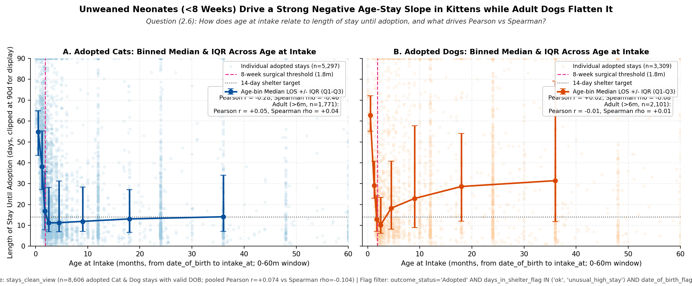
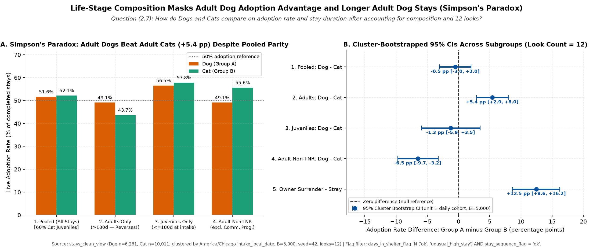

# Exploratory Analysis — Austin Animal Center Shelter Intakes & Outcomes

## 1. Summary

We examined how canonical species, life stage (`juvenile` vs. `adult`), intake channel, and sterilization status relate to shelter length of stay (`length_of_stay_days`) and live adoption rate (`outcome_status = 'Adopted'`) across `17,238` valid completed stays at the Austin Animal Center. Length of stay is strongly right-skewed (`Cat` median `7.30`d, `IQR 21.45`d; `Dog` median `9.19`d, `IQR 27.19`d), causing species rankings to invert between typical median stays (`Small Mammal` #1 at `14.12`d vs. `Wildlife` #6 at `3.95`d) and long-tail 95th-percentile stays (`Wildlife` #1 at `171.7`d; `Dog` #2 at `124.7`d). Crucially, pooled `Dog` vs. `Cat` live adoption parity (`51.6%` vs. `52.1%`, diff `-0.52` pp) masks **Simpson's paradox**: because `60.0%` of Cats are high-adoption juveniles and `40.4%` enter via `Community Program` TNR, stratifying by life stage reveals **Adult Dogs beat Adult Cats by `+5.41` percentage points** (`49.1%` vs. `43.7%`, 95% daily-cohort cluster CI `[+2.88, +8.03]`) while staying `+3.28` days longer at the median. Among adopted pets, neonate foster care under 8 weeks drives a steep negative age-vs-stay correlation in juvenile cats (Spearman $\rho = -0.46$) that flattens in adults and flips pooled Pearson $r$ positive ($r = +0.07$). Seasonal findings remain exploratory across this 17-month window. **M3 issue fixed since `m3` tag:** Section 2.5 exploration surfaced Issue `I-13` (static `MAX_VALID_DATE = '2026-10-08'`), fixed in `src/clean.py`, `src/validate.py`, and `docs/cleaning_report.md`.

---

## 2. Raw versus cleaned

We compared unfiltered M2 raw tables against M3 `stays_clean_view` (`days_in_shelter_flag IN ('ok', 'unusual_high_stay') AND stay_sequence_flag = 'ok'`). Both queries live in [`sql/queries/m4_raw_vs_cleaned_key_metrics.sql`](../sql/queries/m4_raw_vs_cleaned_key_metrics.sql):

```sql
-- =====================================================================
-- M4 Section 2.1 & 2.2: Raw (M2) vs Cleaned (M3) Key Project Numbers
-- Question: How do length of stay (days) and live adoption rate (%)
--           compare between the raw M2 tables and the M3 cleaned layer?
-- Result grain: One row per (layer, animal_group).
-- Flag filter on M3 layer:
--   days_in_shelter_flag IN ('ok', 'unusual_high_stay')
--   AND stay_sequence_flag = 'ok'
-- =====================================================================

WITH raw_stays AS (
    SELECT
        '1_M2_Raw' AS layer,
        CASE
            WHEN a.animal_type IN ('Cat', 'Dog', 'Kitten', 'Puppy', 'Mammal') THEN a.animal_type
            ELSE 'Other_Raw'
        END AS group_label,
        CAST(o.days_in_shelter AS REAL) AS stay_days_int,
        (julianday(o.outcome_at) - julianday(o.intake_at)) AS stay_days_exact,
        CASE WHEN o.outcome_status = 'Adopted' THEN 1.0 ELSE 0.0 END AS is_adopted_exact,
        CASE WHEN o.outcome_status LIKE 'Adopted%' THEN 1.0 ELSE 0.0 END AS is_adopted_any
    FROM outcomes AS o
    JOIN animals  AS a ON a.animal_key = o.animal_key
),
clean_stays AS (
    SELECT
        '2_M3_Cleaned' AS layer,
        s.animal_type AS group_label,
        CAST(s.days_in_shelter AS REAL) AS stay_days_int,
        s.length_of_stay_days AS stay_days_exact,
        CASE WHEN s.outcome_status = 'Adopted' THEN 1.0 ELSE 0.0 END AS is_adopted_exact,
        CASE WHEN s.outcome_status = 'Adopted' THEN 1.0 ELSE 0.0 END AS is_adopted_any
    FROM stays_clean_view AS s
    WHERE s.outcome_at IS NOT NULL
      AND s.days_in_shelter_flag IN ('ok', 'unusual_high_stay')
      AND s.stay_sequence_flag = 'ok'
),
combined AS (
    SELECT * FROM raw_stays
    UNION ALL
    SELECT layer, 'ALL_STAYS' AS group_label, stay_days_int, stay_days_exact, is_adopted_exact, is_adopted_any FROM raw_stays
    UNION ALL
    SELECT * FROM clean_stays
    UNION ALL
    SELECT layer, 'ALL_STAYS' AS group_label, stay_days_int, stay_days_exact, is_adopted_exact, is_adopted_any FROM clean_stays
)
SELECT
    layer,
    group_label,
    COUNT(*) AS n_completed_stays,
    ROUND(AVG(stay_days_int), 2) AS mean_days_integer,
    ROUND(AVG(stay_days_exact), 2) AS mean_los_days,
    ROUND(100.0 * AVG(is_adopted_exact), 2) AS adopted_exact_pct,
    ROUND(100.0 * AVG(is_adopted_any), 2) AS adopted_canonical_pct
FROM combined
GROUP BY layer, group_label
ORDER BY layer, n_completed_stays DESC;
```

| cohort | layer | n | median_los_d | iqr_los_d | mean_los_d | p90_los_d | p95_los_d | adopted_exact_pct | adopted_all_subtypes_pct |
| --- | --- | --- | --- | --- | --- | --- | --- | --- | --- |
| M2 Raw — All Outcomes (unfiltered) | M2 Raw | 17299 | 8.08 | 24.18 | 23.12 | 60.82 | 90.03 | 45.11 | 49.6 |
| M3 Cleaned — All Valid Completed Stays | M3 Cleaned | 17238 | 8.09 | 24.21 | 23.13 | 60.82 | 90.03 | 49.73 | 49.73 |
| M2 Raw — 'Cat' (excludes raw 'Kitten') | M2 Raw | 8424 | 8.76 | 24.23 | 20.86 | 55.92 | 72.98 | 51.8 | 57.34 |
| M2 Raw — 'Kitten' (separate raw type) | M2 Raw | 1612 | 4.08 | 7.96 | 9.35 | 29.27 | 45.44 | 24.26 | 24.5 |
| M3 Cleaned — Canonical 'Cat' (Adult + Juvenile) | M3 Cleaned | 10011 | 7.3 | 21.45 | 19.04 | 52.22 | 69.8 | 52.15 | 52.15 |
| M2 Raw — 'Dog' (excludes raw 'Puppy') | M2 Raw | 5993 | 10.04 | 28.99 | 29.79 | 79.98 | 127.43 | 47.46 | 52.48 |
| M2 Raw — 'Puppy' (separate raw type) | M2 Raw | 311 | 5.04 | 5.93 | 8.91 | 19.22 | 28.62 | 32.8 | 32.8 |
| M3 Cleaned — Canonical 'Dog' (Adult + Juvenile) | M3 Cleaned | 6281 | 9.19 | 27.19 | 28.74 | 77.22 | 124.7 | 51.63 | 51.63 |

**Why numbers differ:** On raw M2 rows (`n = 17,299`), exact `outcome_status = 'Adopted'` captures only `45.11%` adoptions, whereas M3 reports `49.73%` (`n = 17,238`) by consolidating six adoption subtypes (`Adopted Altered`, `Adopted Offsite`, etc.) while filtering `50` duplicate exit rows, `1` negative stays, and `10` sequence errors. Merging raw `Kitten` (`n = 1,612`) and `Puppy` (`n = 311`) into canonical `Cat` and `Dog` prevents species dilution and separates age from taxonomy via `life_stage`.


---

## 3. The question and its summary

**Project Question:** *How do canonical species, life stage (`juvenile` vs. `adult`), intake channel, and sterilization status relate to length of stay (`length_of_stay_days`) and live adoption (`outcome_status = 'Adopted'`)?*

**Summary Choice & Justification:** Because shelter stays start at `0` days and stretch to `484` days, we pair the **median (`p50`) and IQR** (typical stay) with **`p95`** (long-stay kennel burden) and **adoption share (%)**. The mean exceeds `2–3x` the median (`Cat` mean `19.04`d vs. median `7.30`d; `Dog` `28.74`d vs. `9.19`d) due to medical, ringworm, and court holds.

| animal_type | n | passes_coverage_rule | median_d | iqr_d | mean_d | sd_d | p90_d | p95_d | share_gt_14d_pct | share_gt_30d_pct | adoption_rate_pct | rank_by_median | rank_by_mean | rank_by_p95 |
| --- | --- | --- | --- | --- | --- | --- | --- | --- | --- | --- | --- | --- | --- | --- |
| Cat | 10011 | True | 7.3 | 21.45 | 19.04 | 27.95 | 52.22 | 69.8 | 35.3 | 21.5 | 52.2 | 3.0 | 5.0 | 6.0 |
| Dog | 6281 | True | 9.19 | 27.19 | 28.74 | 49.3 | 77.22 | 124.7 | 41.0 | 25.9 | 51.6 | 2.0 | 2.0 | 2.0 |
| Wildlife | 685 | True | 3.95 | 34.98 | 31.75 | 56.69 | 97.78 | 171.72 | 40.4 | 27.0 | 0.0 | 6.0 | 1.0 | 1.0 |
| Small Mammal | 140 | True | 14.12 | 35.28 | 24.96 | 26.24 | 54.07 | 74.42 | 50.7 | 32.1 | 52.1 | 1.0 | 4.0 | 5.0 |
| Bird | 77 | True | 5.8 | 21.48 | 17.07 | 26.64 | 46.58 | 82.89 | 35.1 | 16.9 | 23.4 | 5.0 | 6.0 | 4.0 |
| Reptile | 34 | True | 6.2 | 20.9 | 27.69 | 75.45 | 42.83 | 105.39 | 29.4 | 14.7 | 35.3 | 4.0 | 3.0 | 3.0 |
| Other | 6 | False | 5.45 | 2.58 | 7.88 | 5.4 | 13.32 | 15.97 | 16.7 | 0.0 | 83.3 | nan | nan | nan |
| Livestock | 4 | False | 5.17 | 5.1 | 8.46 | 7.23 | 15.29 | 17.26 | 25.0 | 0.0 | 25.0 | nan | nan | nan |

**Ranking Reversal:** Different summaries answer different questions (Figure 1B). By **median stay**, `Small Mammal` ranks #1 longest (`14.12`d), followed by `Dog` (`9.19`d), `Cat` (`7.30`d), `Reptile` (`6.20`d), `Bird` (`5.80`d), and `Wildlife` #6 shortest (`3.95`d). By **mean and `p95`**, `Wildlife` flips from #6 to **#1 longest (`mean 31.75`d, `p95 171.7`d)** and `Dog` reaches **#2 (`p95 124.7`d)**. Half of wildlife exits happen within 4 days, while overwintering bats and rehab cases stretch past 170 days.

---

## 4. What the data is made of

### 4.1 Distributional Shape (`length_of_stay_days`)

We inspected `length_of_stay_days` using two complementary views (Figure 2): a `0–90`d histogram and a `log1p(days)` ECDF across all `17,238` completed stays. Testing candidate bin widths shows why `2-day` bins work best:

| bin_width_days | n_bins_0_to_90d | primary_mode_bin | primary_mode_count | secondary_mode_bin | empty_bin_pct | assessment |
| --- | --- | --- | --- | --- | --- | --- |
| 1.0 | 90 | [0d, 1d) | 2263 | [3d, 4d) | 0.0 | 1-day (daily bins; noisy sawtooth from weekend/weekday discharge batching) |
| 2.0 | 45 | [0d, 2d) | 3048 | [4d, 6d) | 0.0 | 2-day (chosen: resolves day 0-2 intake triage & day 4 stray-hold peak cleanly) |
| 7.0 | 13 | [0d, 7d) | 7830 | [7d, 14d) | 0.0 | 7-day (weekly bins; over-smooths and hides the 4-day mandatory stray hold) |

Daily `1-day` bins create weekday/weekend discharge sawtooth noise, while `7-day` weekly bins erase the operational **Day-4 mandatory stray hold peak** (`[4d, 6d)`). Across groups, stay duration is **zero-bounded, multi-modal, and heavily right-skewed**:
- **Day `0–2` triage mode:** Immediate wildlife outcomes, owner reclaims, and community cat TNR returns.
- **Day `4–8` clearance peak:** Adults (`Cat` median `6.98`d; `Dog` median `10.26`d) exiting after stray holds and spay/neuter.
- **Foster shoulder (`14–60`d) & tail (`90–484`d):** Juvenile `Cat` (`p90 56.3`d) and `Dog` (`p90 55.3`d) outlast adult cats (`p90 39.2`d) while waiting in foster care; adult dogs drive the longest tail (`p90 92.2`d, max `484`d).


### 4.2 Coverage Table and Coverage Rules

We audited intake counts, closed-stay completion, and field missingness across `(animal_type, life_stage)` and local months ([`sql/queries/m4_coverage_by_species_and_month.sql`](../sql/queries/m4_coverage_by_species_and_month.sql)):

| animal_type | life_stage | n_intakes | n_completed_stays | n_open_stays | completion_rate_pct | dob_coverage_pct | sex_coverage_pct | zip_coverage_pct | health_logged_pct | n_unusual_high_stay |
| --- | --- | --- | --- | --- | --- | --- | --- | --- | --- | --- |
| Cat | juvenile | 6251 | 6008 | 243 | 96.1 | 95.1 | 86.8 | 91.6 | 12.0 | 160 |
| Dog | adult | 4642 | 4136 | 505 | 89.1 | 96.0 | 96.9 | 81.6 | 19.7 | 312 |
| Cat | adult | 4177 | 4003 | 174 | 95.8 | 93.2 | 84.1 | 86.9 | 16.9 | 118 |
| Dog | juvenile | 2211 | 2145 | 66 | 97.0 | 96.5 | 90.4 | 85.9 | 15.5 | 51 |
| Wildlife | unknown | 647 | 514 | 133 | 79.4 | 0.0 | 1.7 | 62.9 | 32.5 | 26 |
| Wildlife | adult | 185 | 152 | 33 | 82.2 | 100.0 | 3.2 | 91.4 | 43.8 | 15 |
| Small Mammal | adult | 82 | 79 | 3 | 96.3 | 100.0 | 82.9 | 79.3 | 15.9 | 0 |
| Bird | unknown | 54 | 52 | 2 | 96.3 | 0.0 | 16.7 | 87.0 | 20.4 | 4 |
| Small Mammal | unknown | 47 | 46 | 1 | 97.9 | 0.0 | 80.9 | 93.6 | 25.5 | 0 |
| Reptile | unknown | 28 | 22 | 6 | 78.6 | 0.0 | 14.3 | 64.3 | 25.0 | 1 |
| Wildlife | juvenile | 22 | 19 | 3 | 86.4 | 100.0 | 0.0 | 63.6 | 31.8 | 1 |
| Bird | adult | 16 | 14 | 2 | 87.5 | 100.0 | 18.8 | 93.8 | 31.3 | 0 |
| Reptile | adult | 16 | 12 | 4 | 75.0 | 100.0 | 12.5 | 56.3 | 6.3 | 2 |
| Small Mammal | juvenile | 15 | 15 | 0 | 100.0 | 100.0 | 86.7 | 93.3 | 0.0 | 0 |
| Bird | juvenile | 11 | 11 | 0 | 100.0 | 100.0 | 18.2 | 72.7 | 18.2 | 0 |
| Other | unknown | 5 | 5 | 0 | 100.0 | 0.0 | 100.0 | 100.0 | 0.0 | 0 |
| Livestock | unknown | 3 | 3 | 0 | 100.0 | 0.0 | 33.3 | 100.0 | 0.0 | 0 |
| Livestock | adult | 2 | 1 | 1 | 50.0 | 100.0 | 100.0 | 100.0 | 0.0 | 0 |
| Other | adult | 1 | 1 | 0 | 100.0 | 100.0 | 0.0 | 100.0 | 0.0 | 0 |

**Thin Entities & Edge Months:** `Other` (`n = 6`) and `Livestock` (`n = 4`) lack sample size, while `Wildlife`, `Bird`, and `Reptile` lack reliable birth dates (`65%–76%` unknown `life_stage`), and `intake_health` is MNAR-logged on only `16.6%` of arrivals (`83.4%` unlogged). Monthly cohorts in `America/Chicago` time show `15/18` months meet completeness rules, whereas `2026-08, 2026-09, 2026-10` fail:

| intake_local_month | calendar_days | active_local_days | first_local_date | last_local_date | n_intakes | n_completed | completion_pct | juvenile_intake_pct | median_los_d | mean_los_d | adoption_rate_pct | passes_coverage_rule | coverage_status |
| --- | --- | --- | --- | --- | --- | --- | --- | --- | --- | --- | --- | --- | --- |
| 2025-05 | 31 | 28 | 2025-05-04 | 2025-05-31 | 1237 | 1233 | 99.7 | 55.8 | 10.83 | 31.82 | 53.9 | True | INCLUDED (complete & uncensored) |
| 2025-06 | 30 | 30 | 2025-06-01 | 2025-06-30 | 1352 | 1344 | 99.4 | 59.8 | 19.07 | 33.25 | 56.7 | True | INCLUDED (complete & uncensored) |
| 2025-07 | 31 | 31 | 2025-07-01 | 2025-07-31 | 1131 | 1117 | 98.8 | 50.0 | 11.8 | 33.61 | 57.8 | True | INCLUDED (complete & uncensored) |
| 2025-08 | 31 | 31 | 2025-08-01 | 2025-08-31 | 1017 | 1012 | 99.5 | 47.0 | 14.07 | 35.22 | 58.8 | True | INCLUDED (complete & uncensored) |
| 2025-09 | 30 | 30 | 2025-09-01 | 2025-09-30 | 1002 | 992 | 99.0 | 49.4 | 13.21 | 32.01 | 55.9 | True | INCLUDED (complete & uncensored) |
| 2025-10 | 31 | 31 | 2025-10-01 | 2025-10-31 | 1069 | 1059 | 99.1 | 44.2 | 10.86 | 30.2 | 50.3 | True | INCLUDED (complete & uncensored) |
| 2025-11 | 30 | 30 | 2025-11-01 | 2025-11-30 | 730 | 712 | 97.5 | 37.5 | 11.12 | 26.71 | 52.7 | True | INCLUDED (complete & uncensored) |
| 2025-12 | 31 | 31 | 2025-12-01 | 2025-12-31 | 649 | 642 | 98.9 | 37.3 | 7.95 | 21.57 | 46.0 | True | INCLUDED (complete & uncensored) |
| 2026-01 | 31 | 31 | 2026-01-01 | 2026-01-31 | 732 | 712 | 97.3 | 29.2 | 7.11 | 22.27 | 51.0 | True | INCLUDED (complete & uncensored) |
| 2026-02 | 28 | 28 | 2026-02-01 | 2026-02-28 | 812 | 785 | 96.7 | 29.7 | 6.92 | 23.63 | 51.3 | True | INCLUDED (complete & uncensored) |
| 2026-03 | 31 | 31 | 2026-03-01 | 2026-03-31 | 949 | 918 | 96.7 | 26.9 | 6.72 | 19.41 | 42.3 | True | INCLUDED (complete & uncensored) |
| 2026-04 | 30 | 30 | 2026-04-01 | 2026-04-30 | 1094 | 1047 | 95.7 | 42.5 | 5.94 | 16.34 | 41.6 | True | INCLUDED (complete & uncensored) |
| 2026-05 | 31 | 31 | 2026-05-01 | 2026-05-31 | 1367 | 1288 | 94.2 | 52.0 | 6.24 | 16.91 | 45.1 | True | INCLUDED (complete & uncensored) |
| 2026-06 | 30 | 30 | 2026-06-01 | 2026-06-30 | 1545 | 1449 | 93.8 | 57.8 | 8.01 | 17.23 | 48.2 | True | INCLUDED (complete & uncensored) |
| 2026-07 | 31 | 31 | 2026-07-01 | 2026-07-31 | 1085 | 991 | 91.3 | 45.2 | 6.97 | 14.59 | 48.9 | True | INCLUDED (complete & uncensored) |
| 2026-08 | 31 | 31 | 2026-08-01 | 2026-08-31 | 1126 | 953 | 84.6 | 45.5 | 6.0 | 9.69 | 49.3 | False | EXCLUDED (right-censored cohort: 84.6% < 85% closed) |
| 2026-09 | 30 | 30 | 2026-09-01 | 2026-09-30 | 1203 | 889 | 73.9 | 47.3 | 4.73 | 5.76 | 35.3 | False | EXCLUDED (right-censored cohort: 73.9% < 85% closed) |
| 2026-10 | 31 | 8 | 2026-10-01 | 2026-10-08 | 315 | 95 | 30.2 | 42.9 | 0.65 | 1.49 | 8.4 | False | EXCLUDED (partial edge month: 8/31 active days) |

**Coverage Rules & Impact (Figure 3A):**
1. **Group Rule:** Species summaries require `n >= 30` completed stays; age-stratified analyses require `>= 80%` DOB coverage (excluding `Wildlife`/`Bird`/`Reptile` from age models).
2. **Monthly Rule:** Monthly points require `>= 20` active local days and `>= 85%` closed outcomes. Without this rule, right-censored trailing cohorts (`2026-08, 2026-09, 2026-10`) falsely plunge median stay to `0.65–6.00`d because only fast exits have closed; applying the rule shifts the median of monthly medians from `7.53`d (`18` months) to `8.01`d (`15` complete months).

### 4.3 The Flag Filter: Stated and Varied

Every M4 query states its flag filter. We compared **Filter A (Reported: `days_in_shelter_flag IN ('ok', 'unusual_high_stay') AND stay_sequence_flag = 'ok'`)** against **Filter B (`days_in_shelter_flag = 'ok'` only)** across the 6 qualifying species (Figure 3B):

| animal_type | n_filter_A_all_valid | n_filter_B_ok_only | n_unusual_removed | median_A_d | median_B_d | mean_A_d | mean_B_d | p95_A_d | p95_B_d | adopt_A_pct | adopt_B_pct |
| --- | --- | --- | --- | --- | --- | --- | --- | --- | --- | --- | --- |
| Cat | 10011 | 9733 | 278 | 7.3 | 7.16 | 19.04 | 15.82 | 69.8 | 59.3 | 52.2 | 51.2 |
| Dog | 6281 | 5918 | 363 | 9.19 | 8.15 | 28.74 | 18.81 | 124.7 | 73.93 | 51.6 | 49.6 |
| Wildlife | 685 | 643 | 42 | 3.95 | 3.03 | 31.75 | 20.0 | 171.72 | 92.1 | 0.0 | 0.0 |
| Small Mammal | 140 | 140 | 0 | 14.12 | 14.12 | 24.96 | 24.96 | 74.42 | 74.42 | 52.1 | 52.1 |
| Bird | 77 | 73 | 4 | 5.8 | 4.99 | 17.07 | 12.08 | 82.89 | 46.58 | 23.4 | 21.9 |
| Reptile | 34 | 31 | 3 | 6.2 | 5.21 | 27.69 | 9.36 | 105.39 | 30.52 | 35.3 | 35.5 |

Medians remain stable under Filter B (`Cat 7.30`d vs. `7.16`d; `Dog 9.19`d vs. `8.15`d), but dropping `unusual_high_stay` cuts `Dog` `p95` nearly in half (`124.7`d -> `73.9`d). Because `unusual_high_stay` represents real long-term shelter residents rather than data errors, we report **Filter A** throughout and keep Filter B as a sensitivity check.


---

## 5. Time

### 5.1 Which Clock and Why

M2 stores `ISO 8601` UTC timestamps (`intake_at`), which lag Austin wall-clock time by 5–6 hours (`CDT/CST`). Shelter operations follow Austin local time, so `fetch_time_indexed_stays()` converts every timestamp to **`America/Chicago`**. Stored UTC falsely puts the intake peak at `17:00` UTC (`16.62%`), whereas Austin local time reveals the real opening surge at **`11:00` local time (`18.67%`)**, with `75.4%` arriving during `11:00–16:00` public hours (`92.3%` between `08:00–18:00`, Figure 4A).

### 5.2 The Edges

In `America/Chicago` time, intakes span `2025-05-04` through `2026-10-08`, leaving `2025-05` slightly partial (`28/31` days post-software cutover) and `2026-10` truncated (`8/31` days), while `2026-08` and `2026-09` fall below `85%` completion. Partial edge months are plotted as shaded gaps rather than connected lines.

### 5.3 Patterns at Two Time Scales

Examining local time at daily and monthly scales reveals two distinct regimes (Figure 4B–C; [`sql/queries/m4_time_patterns_and_edges.sql`](../sql/queries/m4_time_patterns_and_edges.sql)):
- **Fine scale (Day of Week):** Weekday volume holds near `41.4`/day, drops on Saturdays (`22.86`/d), and plunges ~`60%` on **Sundays (`16.56`/d)** because routine owner-surrender desks close (`3.52`/d Sunday vs. `16.88`/d Tuesday) while emergency stray/ACO intake continues.
- **Coarse scale (Seasonal Months):** Adult intake stays relatively flat (`387–607`/month), whereas **juvenile arrivals more than triple during warm-weather breeding season**, surging from winter lows (`214–255`/month in Jan–Mar) to `893` juveniles in June (`58%–60%` of arrivals).

| day_of_week | n_calendar_dates | total_intakes | mean_intakes_per_day | stray_aco_per_day | owner_community_per_day |
| --- | --- | --- | --- | --- | --- |
| Monday | 75 | 3073 | 40.97 | 24.03 | 15.64 |
| Tuesday | 75 | 3293 | 43.91 | 25.32 | 16.88 |
| Wednesday | 75 | 3055 | 40.73 | 24.99 | 14.55 |
| Thursday | 75 | 3045 | 40.6 | 24.49 | 14.4 |
| Friday | 74 | 3015 | 40.74 | 22.11 | 17.23 |
| Saturday | 74 | 1692 | 22.86 | 15.59 | 5.55 |
| Sunday | 75 | 1242 | 16.56 | 11.72 | 3.52 |

### 5.4 The Calendar (Holidays and Known Events)

Checking key US holidays against the median daily intake baseline confirms sharp drops on major holidays (`3–11` intakes/day on Thanksgiving, Christmas, and New Year's Day, `-67.6%` to `-91.2%`) and strong **post-July 4th fireworks stray/ACO spikes** on reopening days (`42` intakes in 2025, `+23.5%`; `64` in 2026, `+88.2%`):

| local_date | calendar_event | n_intakes | stray_aco_intakes | owner_surrenders | vs_median_day_pct | operational_interpretation |
| --- | --- | --- | --- | --- | --- | --- |
| 2025-07-04 | Independence Day (July 4th) | 10 | 10 | 0 | -70.6 | Holiday closure / fireworks evening |
| 2025-07-05 | Post-July 4th Stray Surge (Day +1) | 26 | 18 | 0 | -23.5 | Fireworks runaway impound surge |
| 2025-07-07 | Post-July 4th Weekday Reopening | 42 | 28 | 3 | 23.5 | Post-holiday backlog & stray surge |
| 2025-11-27 | Thanksgiving Day 2025 | 3 | 2 | 0 | -91.2 | Shelter front-desk holiday closure |
| 2025-12-25 | Christmas Day 2025 | 7 | 7 | 0 | -79.4 | Shelter front-desk holiday closure |
| 2026-01-01 | New Year's Day 2026 | 4 | 3 | 0 | -88.2 | Shelter front-desk holiday closure |
| 2026-07-04 | Independence Day 2026 | 11 | 11 | 0 | -67.6 | Holiday closure / fireworks evening |
| 2026-07-07 | Post-July 4th Surge 2026 (Tue) | 64 | 42 | 2 | 88.2 | Post-fireworks stray/ACO impound peak |


---

## 6. Relationships

We plotted `age_at_intake_days` vs. adopted `length_of_stay_days` across `8,411` validated `Cat` and `Dog` adoptions (`date_of_birth_flag = 'ok'`) on shared `0–90`d scales before summarizing (Figure 5).

| animal_type | age_bin | mid_age_months | n | q25_los_d | median_los_d | q75_los_d | mean_los_d |
| --- | --- | --- | --- | --- | --- | --- | --- |
| Cat | 0-4w (<1m) | 0.5 | 357 | 43.35 | 54.77 | 64.88 | 56.88 |
| Cat | 4-6w (1-1.5m) | 1.25 | 799 | 27.28 | 38.19 | 55.2 | 42.93 |
| Cat | 6-8w (1.5-2m) | 1.75 | 605 | 8.07 | 16.97 | 36.09 | 25.15 |
| Cat | 2-3m | 2.5 | 873 | 7.04 | 11.19 | 28.24 | 21.38 |
| Cat | 3-6m | 4.5 | 815 | 7.07 | 12.09 | 31.64 | 23.8 |
| Cat | 6-12m | 9.0 | 588 | 7.14 | 11.96 | 28.36 | 24.52 |
| Cat | 1-2y | 18.0 | 338 | 6.71 | 13.13 | 27.13 | 23.41 |
| Cat | 2-5y | 36.0 | 570 | 7.05 | 14.11 | 33.7 | 28.53 |
| Cat | 5y+ | 72.0 | 236 | 6.2 | 13.97 | 35.09 | 29.77 |
| Dog | 0-4w (<1m) | 0.5 | 54 | 55.18 | 62.71 | 72.03 | 65.71 |
| Dog | 4-6w (1-1.5m) | 1.25 | 79 | 22.97 | 29.18 | 40.56 | 35.08 |
| Dog | 6-8w (1.5-2m) | 1.75 | 198 | 6.97 | 13.08 | 23.93 | 17.57 |
| Dog | 2-3m | 2.5 | 430 | 6.2 | 10.18 | 23.31 | 22.71 |
| Dog | 3-6m | 4.5 | 431 | 8.11 | 18.35 | 41.08 | 34.09 |
| Dog | 6-12m | 9.0 | 593 | 9.03 | 23.08 | 59.0 | 44.93 |
| Dog | 1-2y | 18.0 | 351 | 12.07 | 28.99 | 55.39 | 51.26 |
| Dog | 2-5y | 36.0 | 749 | 12.05 | 31.48 | 79.16 | 59.93 |
| Dog | 5y+ | 72.0 | 345 | 8.29 | 22.19 | 55.14 | 46.6 |

**Opposite Correlation Signs (`r` vs. `rho`):** Pooled linear Pearson correlation is positive (**$r = +0.0698$**) while Spearman rank correlation is negative (**$\rho = -0.1073$**). Figure 5 explains why Spearman $\rho$ and binned medians capture the true shape: legal/medical sterilization requires **8 weeks (`56`d / ~`2` lbs)**, keeping under-4-week cats in foster care for a median `54.8`d (`Dog 62.7`d) and `4–6w` kittens for `38.2`d before dropping sharply to `11.2`d at `2–3` months. Adult medians flatten (`12–14`d Cats; `22–31`d Dogs), while extreme-stay adult dogs (`120–484`d) pull linear Pearson $r$ upward.

| subset_check | n | pearson_r | spearman_rho | median_age_d | median_los_d |
| --- | --- | --- | --- | --- | --- |
| 1. All Adopted Cat + Dog (ok + unusual_high_stay) | 8411 | 0.0698 | -0.1073 | 124.0 | 20.97 |
| 2. Remove unusual_high_stay tail (ok only) | 7878 | -0.0253 | -0.1788 | 122.0 | 18.21 |
| 3. Juvenile Adopted Cats (age <= 180d, all valid) | 3449 | -0.2806 | -0.4637 | 56.0 | 24.21 |
| 4. Juvenile Adopted Cats — remove <42d neonates | 2650 | -0.0771 | -0.2301 | 63.0 | 15.23 |
| 5. Juvenile Adopted Cats — Peak Season (May-Aug) | 2293 | -0.2965 | -0.4636 | 56.0 | 28.01 |
| 6. Juvenile Adopted Cats — Off-Peak (Sep-Apr) | 1156 | -0.2508 | -0.4321 | 62.0 | 20.19 |
| 7. Juvenile Adopted Dogs (age <= 180d, all valid) | 1192 | 0.0183 | -0.0796 | 70.0 | 15.19 |
| 8. Adult Adopted Cats (age > 180d) | 1732 | 0.0515 | 0.0397 | 730.0 | 13.12 |
| 9. Adult Adopted Dogs (age > 180d) | 2038 | -0.0232 | 0.0007 | 731.0 | 27.18 |

**Driver Checks:**
1. **Outliers:** Dropping `unusual_high_stay` (`533` rows) flips pooled Pearson from `+0.0698` to **`-0.0253`** and strengthens Spearman to **`-0.1788`**.
2. **Neonates:** Within juvenile cats (`\rho = -0.4637`), removing `< 42`-day neonates (`799` rows) cuts Spearman in half to **`-0.2301`**, proving neonate maturation is the core driver.
3. **Seasonality Check:** Juvenile cat correlation persists similarly in Peak Season (`-0.4636`) and Off-Peak months (`-0.4321`), ruling out seasonal confounding.



---

## 7. The comparison

### 7.1 Independent Cluster Intervals (`B = 5,000`)

Litters and same-day shelter batches violate stay-level independence, so we bootstrapped **daily intake cohorts (`intake_local_date`, `seed = 42`)** to compare **Dogs (`Group A`, `n = 6,281`, `521` days) vs. Cats (`Group B`, `n = 10,011`, `516` days)** and **Owner Surrenders vs. Strays**:

| comparison_stratum | n_group_A | n_group_B | clusters_A_days | clusters_B_days | median_los_A_d | median_los_B_d | los_diff_A_minus_B_d | los_cluster_95ci | los_naive_95ci | adopt_A_pct | adopt_B_pct | adopt_diff_pct_pt | adopt_cluster_95ci |
| --- | --- | --- | --- | --- | --- | --- | --- | --- | --- | --- | --- | --- | --- |
| 1. Pooled All Completed Stays (Dog vs Cat) | 6281 | 10011 | 521 | 516 | 9.19 | 7.3 | 1.89 | [+1.27, +3.69] | [+1.12, +2.69] | 51.63 | 52.15 | -0.52 | [-3.04, +2.04] |
| 2. Adult Stays Only (Adult Dog vs Adult Cat) | 4136 | 4003 | 519 | 503 | 10.26 | 6.98 | 3.28 | [+3.59, +5.96] | [+2.35, +4.17] | 49.08 | 43.67 | 5.41 | [+2.88, +8.03] |
| 3. Juvenile Stays Only (Juvenile Dog vs Juvenile Cat) | 2145 | 6008 | 408 | 479 | 8.11 | 8.23 | -0.13 | [-1.14, +2.36] | [-0.97, +0.58] | 56.55 | 57.81 | -1.26 | [-5.94, +3.48] |
| 4. Adult Non-TNR Stays (excl. Community Program) | 4136 | 1734 | 519 | 466 | 10.26 | 8.02 | 2.23 | [+2.03, +4.74] | [+1.29, +3.62] | 49.08 | 55.59 | -6.51 | [-9.72, -3.21] |
| 5. Intake Channel: Owner Surrender vs Stray (Cat+Dog) | 1684 | 5524 | 399 | 488 | 8.22 | 9.13 | -0.9 | [-1.00, +2.78] | [-1.67, +0.06] | 70.78 | 58.31 | 12.47 | [+8.63, +16.23] |

### 7.2 Composition Check (Simpson's Paradox)

Checking group composition reveals two major structural imbalances:

| species | n_completed_stays | juvenile_share_pct | adult_share_pct | community_program_share_pct | stray_share_pct | aco_impound_share_pct | owner_surrender_share_pct |
| --- | --- | --- | --- | --- | --- | --- | --- |
| Cat | 10011 | 60.0 | 40.0 | 40.4 | 33.2 | 13.3 | 8.4 |
| Dog | 6281 | 34.2 | 65.8 | 0.1 | 35.1 | 40.3 | 13.4 |

**`60.0%` of Cat stays are Juveniles vs. `34.2%` of Dogs**, and **`40.4%` of Cats enter via `Community Program` TNR vs. `0.1%` of Dogs**, creating **two Simpson's paradox reversals** (Figure 6):
1. **Adoption Paradox:** Pooled parity (`51.6%` Dog vs. `52.1%` Cat; diff `-0.52` pp, cluster CI `[-3.04, +2.04]`) reverses within adults, where **Adult Dogs exceed Adult Cats by `+5.41` pp** (`49.1%` vs. `43.7%`, cluster CI `[+2.88, +8.03]`) because high-adoption juveniles inflate Cat totals while TNR suppresses Adult Cat adoptions (excluding TNR reverses adults again to `-6.51` pp).
2. **LOS Reversal:** Pooled Dogs stay `+1.89`d longer (`9.19`d vs. `7.30`d), led by adults (`+3.28`d), but **Juvenile Cats stay slightly longer than Juvenile Dogs** (`8.23`d vs. `8.11`d`, diff `-0.13`d).

### 7.3 Candidate Looks (`LOOK_COUNT = 12`)

To control multiplicity, we logged all `12` inspected contrasts:

| look_index | candidate_comparison | observed_contrast | disposition |
| --- | --- | --- | --- |
| 1 | Dog vs Cat — Pooled Median LOS | +1.90 d | Selected (part of focal comparison) |
| 2 | Dog vs Cat — Pooled Adoption Share | -0.1% to -0.9% | Confounded by juvenile & TNR mixture |
| 3 | Adult Dog vs Adult Cat — Adoption Share | +5.4% to +5.6% | Selected (Simpson's paradox reversal) |
| 4 | Juvenile Dog vs Juvenile Cat — Median LOS | -0.04 d to -0.11 d | Selected (juvenile reversal vs adults) |
| 5 | Owner Surrender vs Stray — Adoption Share | +12.1% to +12.5% | Selected (secondary channel benchmark) |
| 6 | ACO Impound vs Stray — Adoption Share | -21.2% | Exploratory channel contrast |
| 7 | Male vs Female — Median LOS (Cat+Dog) | -0.35 d | Small difference; not focal |
| 8 | Previously Spayed/Neutered vs Intact at Intake — LOS | -1.82 d | Confounded by age at intake |
| 9 | Peak Kitten Season (May-Aug) vs Winter (Nov-Feb) — Cat LOS | +2.10 d | Seasonal foster backlog |
| 10 | Named vs Unnamed at Intake — Adoption Share | +9.4% | Proxy for Owner Surrender vs Stray |
| 11 | Logged Abnormal Health vs Logged Normal — LOS | +6.40 d | Restricted to 16.6% MNAR logged subset |
| 12 | Wildlife vs Companion Animals — Same-Day Exit Share | +68.5% | Structural triage difference |

Adult Dog vs. Adult Cat adoption gap (`+5.41` pp) and Owner Surrender vs. Stray advantage (`+12.47` pp, CI `[+8.63, +16.23]`) remain clear even under Bonferroni adjustment ($\alpha = 0.05/12 = 0.0042$).



---

## 8. Findings

| ID | Finding (one sentence) | Evidence (figure / query) | Label | What would change it | Explored by |
|---|---|---|---|---|---|
| `F-01` | Consolidating six raw adoption subtypes (`Adopted Altered`, `Adopted Offsite`, etc.) into canonical `Adopted` lifts measured adoption rate from `45.11%` to `49.73%`, while merging `Kitten`/`Puppy` reduces `Cat` mean stay from `20.86`d to `19.04`d. | `m4_raw_vs_cleaned_key_metrics.sql`; `fig1` (Panel A) | Confirmed (mapping arithmetic) | Reclassifying `Adopted to Finder` or `Adopted Unaltered` in M7 target definitions. | Osman Kalkan |
| `F-02` | Species LOS rankings invert between the median (`Small Mammal` #1 at `14.12`d, `Wildlife` #6 at `3.95`d) and `p95` (`Wildlife` #1 at `171.7`d, `Dog` #2 at `124.7`d) due to heavy rehab/legal-hold tails up to `484`d. | Section 3 Table; `fig1` (Panel B); `fig2` | Exploratory | Resolving `1,176` open stays or changing wildlife/court-hold transfer rules. | Osman Kalkan |
| `F-03` | Without our monthly coverage rule (`>=20` active days & `>=85%` closed), trailing censored cohorts (`2026-08, 2026-09, 2026-10`) falsely plunge median stay to `0.65–6.00`d; dropping `unusual_high_stay` under Filter B leaves medians flat (`~7–9`d) while halving `Dog` `p95` (`124.7`d to `73.9`d). | `m4_coverage_by_species_and_month.sql`; `fig3` | Confirmed (censoring & truncation mechanics) | Re-snapshotting October 2026 intakes 90+ days later after open stays close. | Osman Kalkan |
| `F-04` | Grouping stored UTC shifts Austin's `11:00–16:00` local daytime surge by 5–6h into `17:00` UTC; Sunday desk closures cut intakes ~`60%` (`16.56`/d) while July 4th fireworks drive reopening spikes (`+23.5%` to `+88.2%`). | `m4_time_patterns_and_edges.sql`; `fig4` (Panels A–B) | Exploratory | Changes to Austin front-desk Sunday hours or multi-year holiday baselines. | Irmak Köse |
| `F-05` | Summer breeding seasonality more than triples monthly juvenile intakes (`214` in Jan vs. `893` in Jun) while adult arrivals stay stable (`387–607`/month). | `fig4` (Panel C) | Exploratory | Multi-year historical baseline separating recurring climate cycles from policy shifts. | Irmak Köse |
| `F-06` | Among `8,411` adopted pets, pooled Pearson ($r=+0.0698$) and Spearman ($\rho=-0.1073$) take opposite signs because `<42`d unweaned kittens drive a steep juvenile cat foster slope ($\rho=-0.4637$, halved to `-0.2301` without neonates) while long-stay adult dogs lift Pearson $r$. | Section 6 Table; `fig5` | Exploratory | Direct intake weights and foster transfer timestamps per animal. | Irmak Köse |
| `F-07` | Pooled `Dog` vs. `Cat` adoption parity (`51.6%` vs. `52.1%`, diff `-0.52` pp) hides **Simpson's paradox**: Adult Dogs beat Adult Cats by `+5.41` pp (`49.1%` vs. `43.7%`, CI `[+2.88, +8.03]`) due to `60.0%` juvenile and `40.4%` TNR Cat composition. | `m4_age_los_and_subgroup_comparison.sql`; `fig6` (Panel A) | Confirmed (composition / Simpson's paradox) | Excluding `Community Program` TNR cats flips adults back toward Cats (`55.6%` vs. `49.1%`). | Ferdi Derebaşı |
| `F-08` | `Owner Surrender` stays achieve `+12.47` pp higher adoption than `Stray` arrivals (`70.8%` vs. `58.3%`, cluster CI `[+8.63, +16.23]`) after `12` looks and avoid the 4-day stray hold (`-0.90`d median diff). | Section 7.1 Table; `fig6` (Panel B) | Exploratory | Adjusting for intake health, age, and breed mix on held-out M7 models. | Ferdi Derebaşı |

### Back to cleaning

Edge-period checks revealed **`Issue I-13`** in M3 ([`docs/cleaning_report.md`](cleaning_report.md)), resolved in [`src/clean.py`](../src/clean.py), [`src/clean_config.py`](../src/clean_config.py), and [`src/validate.py`](../src/validate.py): `MAX_VALID_DATE = "2026-10-08"` previously flagged valid post-Oct 8 neonates as `invalid_future_date`, and `WARN-2` checked stale Oct 1–8 dates. We anchored future-DOB checks dynamically to `max(MAX_VALID_DATE, retrieved_at[:10])` and freshness checks to `MAX(substr(intake_at, 1, 10))`; all 3 `STOP` checks and self-tests pass.

### Forward to modelling

M7 predictive modelling must enforce five guardrails:
1. **Target & loss:** Predict `log1p(length_of_stay_days)` or quantile loss (`p50`/`p90`) rather than raw MSE, evaluating on both Filter A and Filter B.
2. **Interactions:** Include `animal_type * life_stage * intake_type` to capture non-linear neonate maturation and Simpson reversals (`F-06`, `F-07`).
3. **Leakage ban:** Exclude post-outcome fields (`outcomes_clean.spayed_neutered`, `euthanasia_reason`); use only `intakes_clean.previously_spayed_neutered`.
4. **Censoring-aware splits:** Exclude cohorts within 30–45 days of snapshot cutoff or use survival metrics.
5. **Thin groups & MNAR indicators:** Drop `Livestock`/`Other` from species claims and encode `83.4%` unlogged `intake_health` and unknown sex as explicit levels.

---

## 9. What we can't say

Across `18,415` valid-sequence stays (`17,238` closed), four boundaries limit inference:
1. **Single 17-month window (`2025-05-04`–`2026-10-08`):** Only one full winter cycle appears after the May 2025 software migration, preventing separation of weather seasonality from policy changes.
2. **Boundary censoring:** `1,176` recent intakes remain open (`outcome_at IS NULL`) alongside `1,088` pre-cutover `quarantine` exits, slightly understating multi-year stays.
3. **Unobserved clinical & foster records:** Front-desk health is `83.4%` unlogged (`MNAR`), and SODA omits weights, foster transfer dates, and behavior scores.
4. **No causal claims:** Gaps like `+12.5` pp (`Owner Surrender` vs. `Stray`) reflect unmeasured socialization and medical history confounding rather than causal channel effects.
