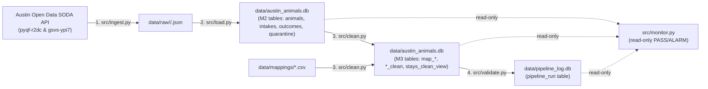

# Pipeline — Austin Animal Center

## 1. The graph



`src/run_pipeline.py` runs each step in order (`ingest -> load -> clean -> validate`) as its own Python process. All steps use the same UTC clock (`--run-time` / `PIPELINE_RUN_TIME`), and each step writes one row to `data/pipeline_log.db`.

| Step | Script | Input | Output | Timeout | Can be rebuilt from |
|---|---|---|---|---:|---|
| 1. Ingest | `src/ingest.py` | SODA API (`pyqf-r2dc`, `gsvs-ypi7`), last success in `data/pipeline_log.db` | `data/raw/intakes/<UTC>.json`, `data/raw/outcomes/<UTC>.json` | 600s | SODA API (up to `SOURCE_MEMORY_DAYS` = 540 days back) |
| 2. Load | `src/load.py` | All JSON files in `data/raw/<source>/` | M2 `STRICT` tables (`animals`, `intakes`, `outcomes`, `quarantine`) in `data/austin_animals.db` | 300s | `data/raw/` files (offline, gives the same result every time) |
| 3. Clean | `src/clean.py` | M2 tables in `data/austin_animals.db` + `data/mappings/*.csv` | M3 `STRICT` tables (`map_*`, `animals_clean`, `intakes_clean`, `outcomes_clean`, `stays_clean_view`) | 300s | M2 tables + `data/mappings/*.csv` (M2 tables stay untouched) |
| 4. Validate | `src/validate.py` | M2 + M3 tables in `data/austin_animals.db` (`connect(create=False)`) | Check report in stdout/log; exits `0` or `1` | 180s | `data/austin_animals.db` + `--run-time` |

---

## 2. Design decisions

| Decision | Our choice | Why |
|---|---|---|
| **Ingestion: where each run starts** | Incremental window `[last_success - OVERLAP_HOURS, run_time]`; full fetch if `data/raw/` is empty or `--full` is given | We read `last_success` from `pipeline_run` (`step = 'src/ingest.py'` and `exit_code = 0`), or from the latest filename in `data/raw/` if there is no log yet. If a run is missed, the next run fetches everything since the last good run automatically. |
| **Overlap** | `OVERLAP_HOURS = 48` (2 days) | From our delay table below, the biggest gap between `retrieved_at` and the newest record is **13.24 hours** (overnight closing), and late same-day entries can be **4.58 hours** behind. 48 hours gives more than 3x margin so we do not miss late rows. |
| **Loading** | Full reload of all files in `data/raw/` inside one SQLite transaction | Right now, loading ~40,000 raw records takes about **1.82s** (and the full offline rebuild `load + clean + validate` takes ~5.2s). The shelter adds about 35–40 intakes per day (~14,000 rows/year), so full reload will stay under 10 seconds for years. It would only stop being acceptable around 500,000+ raw rows (~30+ years of data, or >60 seconds per run), when we would switch to a manifest table. |
| **Version rule** | `retrieved_at` with strict guard `WHERE excluded.retrieved_at > <table>.retrieved_at` | The newest download always wins, no matter which order files are loaded. Re-loading an old file cannot undo a newer row (tested in Drill 6). |
| **Cleaning** | Full rebuild of `map_*` and `*_clean` on every run | It takes about **3.0s** and checks M2 table SHA-256 hashes before and after so M2 data never changes. Because species IQR limits (`Q3 + 3*IQR`) are calculated on all rows, a few old rows near the limit can change their `unusual_high_stay` flag as new history is added. Rebuilding avoids stale rows and batch-split bugs. |
| **The clock** | `--run-time` (UTC, defaults to now), passed to every step via `--run-time` and `PIPELINE_RUN_TIME` | Every step uses the same clock for freshness, future-date limits, and fetch windows, so re-running with the same `--run-time` gives the same database. |
| **Database connection** | `src/db.connect(create=False)` by default; only `src/load.py` uses `create=True` | If the DB path is wrong, `clean.py` or `validate.py` fails immediately instead of making an empty SQLite file. |

### How late our data arrives

We ran `python src/ingest.py --measure-delay` on our saved raw snapshots to compare each file's `retrieved_at` time with the newest record inside it:

| Source | Raw File | Records | `retrieved_at` (UTC) | Newest Record (UTC) | Max Delay (`retrieved_at - newest`) | Notes |
|---|---|---:|---|---|---:|---|
| `intakes` | `20261008T195257Z.json` | 18,426 | `2026-10-08T19:52:57Z` | `2026-10-08T18:55:00Z` | `0.97 h` | 4 late rows (`id=38011..38015`) added up to `4.58 h` later |
| `intakes` | `20261008T213334Z.json` | 18,428 | `2026-10-08T21:33:34Z` | `2026-10-08T20:37:00Z` | `0.94 h` | Same-day late lag `4.58 h` |
| `intakes` | `20261103T143405Z.json` | 19,130 | `2026-11-03T14:34:05Z` | `2026-11-03T13:44:00Z` | `0.83 h` | Overnight gap `16.55 h` (top 10 rows) |
| `intakes` | `20261123T185501Z.json` | 770 | `2026-11-23T18:55:01Z` | `2026-11-23T17:44:00Z` | `1.18 h` | Incremental fetch |
| `outcomes` | `20261008T213339Z.json` | 18,387 | `2026-10-08T21:33:39Z` | `2026-10-08T19:55:52Z` | `1.63 h` | Normal afternoon lag |
| `outcomes` | `20261103T143429Z.json` | 19,525 | `2026-11-03T14:34:29Z` | `2026-11-03T01:20:00Z` | **`13.24 h`** | Shelter closed overnight after 19:00 local time |
| `outcomes` | `20261123T185537Z.json` | 722 | `2026-11-23T18:55:37Z` | `2026-11-23T17:47:00Z` | `1.14 h` | Incremental fetch |

Because the longest measured delay is `13.24 h`, setting `OVERLAP_HOURS = 48` easily covers both overnight pauses and late entries.

### The source's memory

- **How far back we can fetch:** `SOURCE_MEMORY_DAYS = 540` (~18 months). The live Austin SODA API (`pyqf-r2dc` and `gsvs-ypi7`) keeps records back to May 4, 2025.
- **What outage loses data & how we notice:** If the pipeline is offline longer than 540 days, records older than that window could be gone from the live feed. `src/ingest.py` checks `(run_time - last_success) > SOURCE_MEMORY_DAYS`, prints a `[WARN]` naming the gap, and exits with code `1` instead of doing a quiet partial fetch.
- **Per-run catch-up limit:** `MAX_RECORDS_PER_RUN = 50,000` (>2.5x the whole dataset), which bounds each run safely.

---

## 3. Operations

- **Run by hand:**
  ```bash
  python src/run_pipeline.py                             # full run: ingest -> load -> clean -> validate
  python src/run_pipeline.py --run-time 2026-11-23T18:00:00Z
  python src/monitor.py                                  # read-only external health check
  python src/monitor.py --now 2026-11-24T12:00:00Z
  ```
- **Rebuild / backfill:**
  ```bash
  # Offline rebuild from landed data/raw/ files (no network, used after cleaning fixes)
  python src/run_pipeline.py --skip-ingest --run-time 2026-11-23T18:00:00Z

  # Full API re-fetch if we ever need to re-download the full history
  python src/ingest.py --full
  python src/run_pipeline.py --skip-ingest
  ```
  Running `python src/run_pipeline.py --skip-ingest --run-time 2026-11-23T18:00:00Z` twice produces the exact same SHA-256 hashes for all 10 tables in `data/austin_animals.db`.
- **Exit codes:**
  - `0` — success (all steps passed; `validate.py` has 0 `STOP`; `monitor.py` has 0 `ALARM`)
  - `1` — a step failed, a `STOP` check failed, `monitor.py` raised an `ALARM`, or a DB/config is missing
  - `75` — another run already holds `data/pipeline.lock`; second run does nothing
  - `124` — a step hit its timeout and was stopped
- **Logs:**
  - Run log database: `data/pipeline_log.db` (table `pipeline_run`, ignored in `.gitignore`)
  - Pipeline text log: `logs/pipeline.log`
  - Scheduled monitor text log: `logs/monitor.log`
  - Lock file while running: `data/pipeline.lock` (removed in `finally`)

---

## 4. Evidence

### The schedule

- **Machine:** Ferdi Derebaşı's Windows computer.
- **Pipeline task:** `\AustinAnimalCenterPipeline` (committed in `ops/task_scheduler.xml`), runs `python.exe src\run_pipeline.py` **every 6 hours** (`03:37, 09:37, 15:37, 21:37` local time), `StartWhenAvailable=true`, `MultipleInstancesPolicy=IgnoreNew`.
- **Monitor task (dead man's switch):** `\AustinAnimalCenterMonitor` (committed in `ops/task_scheduler_monitor.xml`), runs `python.exe src\monitor.py --log-file logs\monitor.log` **every 6 hours** (`03:50, 09:50, 15:50, 21:50` local time, 13 minutes after the pipeline) as a separate task.

### The run log

> *Pending Day 7 (Nov 29, 2026): Ferdi will paste the 7-day SQL summary query and output from `data/pipeline_log.db` here before tagging `m5`.*

### Missed runs

On **2026-11-27 (Friday)**, after the `03:37` (`00:37:03Z`) and `09:37` (`06:37:03Z`) scheduled runs finished cleanly, we disabled `\AustinAnimalCenterPipeline` at `11:30` local time (`08:30Z`) while leaving `\AustinAnimalCenterMonitor` enabled as our dead man's switch. Two consecutive scheduled runs (`15:37` and `21:37` local time) were missed on purpose.

1. **Detected by `monitor.py` before recovery (`2026-11-27T18:58:22Z` automatic scheduled check & `19:00:36Z` manual check, exit code `1`):**
   ```text
   [ALARM] check_1_last_success: last full success 2026-11-27T06:37:03Z is 12.39h before --now (limit=12.0h)
   [PASS ] check_2_gaps: 18 run(s) in last 7d; max gap=6.22h (limit=12.0h)
   [ALARM] check_3_completeness: 1 missing day-species slot(s) in [2026-11-20..2026-11-26]: 2026-11-26/Cat
   [PASS ] check_4_freshness: all core species within 48h of 2026-11-27T19:00:36Z: Cat=44.18h (2026-11-25T22:50:00Z), Dog=26.54h (2026-11-26T16:28:00Z)
   ```
   *(Note: `2026-11-26/Cat` had 0 intakes because `2026-11-26` was US Thanksgiving Day and Austin Animal Center's front desk was closed — only 4 emergency Dog intakes arrived that day, matching our M4 holiday finding.)*

2. **Re-enabled `\AustinAnimalCenterPipeline` and ran recovery (`run_id = 48a945f4`, `2026-11-27T19:01:14Z`, exit code `0`):**  
   `src/ingest.py` automatically read `last_success = 2026-11-27T06:37:03Z` from `pipeline_log.db`, fetched the 48-hour overlap window (`40` intakes + `17` outcomes), and loaded the new `2026-11-27` arrival that came in during the outage (`2026-11-27T17:44:00Z`). All 4 steps succeeded with `WARN=0 | STOP=0`.

3. **Completeness & `monitor.py` before vs. after recovery:**

   | Metric (SQL check on `austin_animals.db` / `monitor.py`) | Before Recovery (`19:00:36Z`) | After Recovery (`19:01:58Z`) |
   |---|---|---|
   | `check_1_last_success` | **`ALARM`** (`12.39h > 12.0h`) | **`PASS`** (`0.01h <= 12.0h`) |
   | `check_2_gaps` | `PASS` (`max gap = 6.22h`) | **`ALARM`** (`worst = 12.40h` between `06:37:03Z` and `19:01:14Z`) |
   | `MAX(intake_at)` | `2026-11-26T16:28:00Z` | `2026-11-27T17:44:00Z` (`Dog` lag `26.54h -> 1.30h`) |
   | `2026-11-27` UTC intakes (`Cat` / `Dog`) | `0` / `0` (total `0`) | `0` / `1` (total `1`, +1 new animal `19,259 -> 19,260`) |
   | `2026-11-24..2026-11-25` (`Cat` / `Dog`) | `26/22`, `19/15` | `26/22`, `19/15` (unchanged, no duplicates) |

   The next scheduled run (`2026-11-28 03:37` local time) continued on its normal 6-hour schedule.

### Drills

We ran Drills 1–4 and 6 on `2026-11-23` using temporary copies of the database, log database, lock file, and raw folder so the real database stayed clean, and ran Drill 5 live on Ferdi's Windows schedule on `2026-11-27`:

| Drill | What we did | Exit Code | What the log / output showed |
|---|---|---:|---|
| **1. Credential failure** | Set `AUSTIN_APP_TOKEN=INVALID_DRILL_TOKEN_99999` and ran `run_pipeline(run_time='2026-11-23T20:00:00Z')` | `1` | API returned `HTTP 403 Unauthorized/Forbidden ("Invalid app_token specified")`. Runner stopped after `src/ingest.py`; `load`, `clean`, and `validate` did not run. Only **1 row** was logged: `('src/ingest.py', 1, 'records_landed=0+0')`. |
| **2. A step that fails** | Copied `data/austin_animals.db` (SHA-256 `aa8d15d898924ecd`), put a broken JSON file (`{CORRUPT JSON`) in temp `RAW_DATA_DIR/intakes/`, ran `run_pipeline(skip_ingest=True)` | `1` | `src/load.py` failed on JSON parse and rolled back. Runner exited `1` and did not run `clean.py` or `validate.py`. DB hash stayed **`aa8d15d898924ecd`** (`unchanged=True`). Logged: `('src/load.py', 1, 'STATUS: FAILED (transaction rolled back, nothing from this run was written)')`. |
| **3. A step that hangs** | Ran `run_pipeline(skip_ingest=True, timeout_override=1)` so `src/load.py` (~1.82s) passed the 1s limit | `124` | Runner caught `subprocess.TimeoutExpired`, killed `src/load.py`, exited **`124`**, and logged `('src/load.py', 124, 'timed out')`. |
| **4. Two runs at once** | Created `d4.lock` with `acquire_lock()` and started a second `run_pipeline(..., lock_path=d4.lock)` | `75` | Second run printed `[LOCK] Another pipeline run is already in progress (...). Exiting with code 75.`, exited **`75`**, and ran 0 steps (`log_db_created=False`). |
| **5. Missed runs** | Disabled `\AustinAnimalCenterPipeline` on `2026-11-27` (`11:30–22:01` local time) to skip the `15:37` and `21:37` runs, then re-enabled it | `1` (`monitor`), `0` (recovery) | Scheduled `monitor.py` raised `ALARM` on `check_1_last_success` (`12.36h > 12.0h`). After re-enabling, `run_id=48a945f4` recovered the missed window (`40+17` records, `MAX(intake_at)` updated to `2026-11-27T17:44:00Z`), `check_1_last_success` returned to `PASS`, and `check_2_gaps` logged the `12.40h` gap. |
| **6. Old file re-loaded** | Loaded a newer file (`20261123T200000Z.json`, `animal_id='A999999'`, `sex='Female'`), then re-loaded an older file (`20261120T100000Z.json`, `sex='Unknown'`) | `0` | Newer row stayed untouched because of `WHERE excluded.retrieved_at > animals.retrieved_at`: `animals=('A999999', 'Female', '2026-11-23T20:00:00Z')`. |

#### `src/monitor.py` Read-Only & Forced-ALARM Tests (4/4 Checks)

- **Read-only test:** Running `DELETE FROM pipeline_run` on `connect_readonly()` failed with `sqlite3.OperationalError: attempt to write a readonly database`.
- **Normal run (`python src/monitor.py`):** exited `0` with all 4 checks `[PASS ]`.
- **Each check forced to `ALARM` on temp DB copies (all exited `1`):**
  1. **Check 1 (`last_success > 12h`):** `--now 2026-11-24T15:30:00Z` -> `[ALARM] check_1_last_success: last full success 2026-11-23T19:27:29Z is 20.04h before --now (limit=12.0h)`
  2. **Check 2 (`gaps > 12h`):** Added an old row at `2026-11-22T12:00:00Z` in temp log DB -> `[ALARM] check_2_gaps: 1 gap(s) > 12.0h in last 7d (worst=31.46h between 2026-11-22T12:00:00Z and 2026-11-23T19:27:29Z)`
  3. **Check 3 (`completeness`):** Deleted `Dog` intakes for `2026-11-20` in temp DB -> `[ALARM] check_3_completeness: 1 missing day-species slot(s) in [2026-11-16..2026-11-22]: 2026-11-20/Dog`
  4. **Check 4 (`freshness > 48h`):** Tested `--now 2026-11-26T19:00:00Z` against `2026-11-23` data -> `[ALARM] check_4_freshness: Cat=72.08h > 48h (latest=2026-11-23T18:55:00Z); Dog=72.10h > 48h (latest=2026-11-23T18:54:00Z)`

### `monitor.py` on the day we tagged

> *Pending Day 7 (Nov 29, 2026): Ferdi will paste the final `python src/monitor.py` output here on submission day.*

---

## 5. What can still go wrong

Even with `src/validate.py` and `src/monitor.py`, some problems would still not be caught automatically:

1. **Meaning changes inside valid labels:** If the shelter starts logging rescue transfers as `"Adopted"`, the value is still in `data/mappings/outcome_status.csv`, so all `STOP` and `WARN` checks will still pass.
2. **Edits older than 48 hours:** Incremental runs only re-fetch the last 48 hours before `last_success`. If a staff member fixes an animal's `sex` or `date_of_birth` a week later, our pipeline will not see that edit until someone runs a manual `--full` fetch.
3. **Computer off with no email/SMS alerts:** `monitor.py` runs on the same Windows machine and writes to `logs/monitor.log`, so if the laptop stays off for several days, nobody gets an email or phone alert until someone checks the computer.
4. **Half-missing day inside normal volume:** If the API only returns half of a day's animals (for example 15 instead of 35) with HTTP 200, both the volume check (0 or >10x median) and daily completeness (at least 1 Cat and 1 Dog) will still say `PASS`.
5. **Leftover lock file after a sudden power cut:** If the computer shuts off hard in the middle of a run before `finally` removes `data/pipeline.lock`, later runs will exit `75` until someone deletes the old lock file (`monitor.py` will catch this after 12 hours via `check_1_last_success`).
