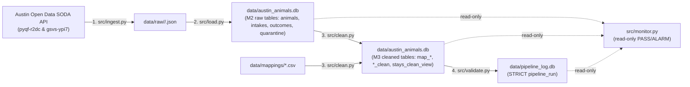

# Pipeline — Austin Animal Center

## 1. The graph



Every step runs as a separate subprocess under `src/run_pipeline.py` in strict order (`ingest -> load -> clean -> validate`), sharing one UTC clock (`PIPELINE_RUN_TIME`) and writing one row per executed step to `data/pipeline_log.db`.

| Step | Script | Reads (Input) | Writes (Output) | Timeout | Rebuildable From |
|---|---|---|---|---:|---|
| 1. Ingest | `src/ingest.py` | Socrata SODA API (`pyqf-r2dc`, `gsvs-ypi7`), `data/pipeline_log.db` (last success) | `data/raw/intakes/<UTC>.json`, `data/raw/outcomes/<UTC>.json` | 600s | Upstream SODA API within `SOURCE_MEMORY_DAYS` (540 days) |
| 2. Load | `src/load.py` | All landed files in `data/raw/<source>/*.json` | M2 `STRICT` tables (`animals`, `intakes`, `outcomes`, `quarantine`) in `data/austin_animals.db` | 300s | `data/raw/` (100% offline, deterministic, idempotent) |
| 3. Clean | `src/clean.py` | M2 tables in `data/austin_animals.db` + committed `data/mappings/*.csv` | M3 `STRICT` tables (`map_*`, `animals_clean`, `intakes_clean`, `outcomes_clean`, `stays_clean_view`) | 300s | M2 tables + `data/mappings/*.csv` (M2 tables hashed before & after) |
| 4. Validate | `src/validate.py` | M2 + M3 tables in `data/austin_animals.db` (`connect(create=False)`) | Validation report on stdout/log; exit `0` (PASS/INFO/WARN) or `1` (STOP) | 180s | `data/austin_animals.db` + `--run-time` |

---

## 2. Design decisions

| Area | Decision | Justification & Measured Evidence |
|---|---|---|
| **Ingestion** | Self-healing incremental window `[last_success - OVERLAP_HOURS, run_time]`; full fetch on empty `data/raw/` or `--full` | Reads `last_success` from `pipeline_run` (`step='src/ingest.py' AND exit_code=0`), falling back to latest filename timestamp in `data/raw/`. Automatically catches up across missed runs without manual intervention. |
| **Overlap** | `OVERLAP_HOURS = 48` (2 full days) | Measured max frontier publication delay across snapshots is **13.24 hours** (overnight discharge pause) and max same-day backdated entry lag is **4.58 hours**. 48h provides **>3.6x** safety margin over frontier delay and **>10x** over same-day lag. |
| **Loading** | Full atomic reload of `data/raw/` inside one SQLite transaction (`with con:`) | Measured full reload of ~40,000 raw records takes **1.82s** (`load=1.82s`, `clean=3.00s`, `validate=0.38s`, total **5.20s**). Full reload is fast enough to avoid fragile incremental loader state while keeping `load.py` 100% deterministic. |
| **Version rule** | Last-writer-wins by `retrieved_at` with strict guard `WHERE excluded.retrieved_at > <table>.retrieved_at` | Prevents an older raw file replayed later from overwriting a newer record version (verified in Drill 6) and guarantees bit-for-bit idempotence on re-runs. |
| **Cleaning** | Full atomic rebuild of `map_*` and `*_clean` inside one transaction; M2 tables verified untouched by SHA-256 | Takes **3.00s** across 19,016 animals, 19,833 intakes, and 18,879 outcomes. Rebuilding from M2 tables guarantees no stale flags or orphaned cleaned rows can accumulate. |
| **Clock** | Shared UTC clock (`--run-time` -> `PIPELINE_RUN_TIME` -> current UTC via `src/db.get_run_time()`) | Every step in a run evaluates freshness, DOB ceilings, and ingestion windows against the exact same ISO 8601 UTC timestamp (`YYYY-MM-DDTHH:MM:SSZ`), enabling reproducible replays and historical backfills. |
| **Connection guard** | `src/db.connect(create=False)` by default; only `src/load.py` passes `create=True` | Prevents `clean.py`, `validate.py`, or `monitor.py` from silently creating an empty SQLite file if `DB_PATH` is misconfigured. |

### How late our data arrives

Measured with `python src/ingest.py --measure-delay` across landed `data/raw/` snapshots:

| Source | Landed Raw File | Records (`n`) | `retrieved_at` (UTC) | Latest Event Timestamp (UTC) | Frontier Delay (`retrieved_at - max(event_utc)`) | Same-Day Backdated / Top-10 Recent Lag |
|---|---|---:|---|---|---:|---:|
| `intakes` | `20261008T195257Z.json` | 18,426 | `2026-10-08T19:52:57Z` | `2026-10-08T18:55:00Z` | `0.97 h` | `4.58 h` (4 late-entered records `id=38011..38015` between Oct 8 pulls) |
| `intakes` | `20261008T213334Z.json` | 18,428 | `2026-10-08T21:33:34Z` | `2026-10-08T20:37:00Z` | `0.94 h` | `4.58 h` |
| `intakes` | `20261103T143405Z.json` | 19,130 | `2026-11-03T14:34:05Z` | `2026-11-03T13:44:00Z` | `0.83 h` | `16.55 h` (overnight intake gap) |
| `intakes` | `20261123T185501Z.json` | 770 | `2026-11-23T18:55:01Z` | `2026-11-23T17:44:00Z` | `1.18 h` | `18.35 h` |
| `outcomes` | `20261008T213339Z.json` | 18,387 | `2026-10-08T21:33:39Z` | `2026-10-08T19:55:52Z` | `1.63 h` | `3.45 h` |
| `outcomes` | `20261103T143429Z.json` | 19,525 | `2026-11-03T14:34:29Z` | `2026-11-03T01:20:00Z` | **`13.24 h`** | `14.72 h` (overnight discharge pause after 19:00 local closing) |
| `outcomes` | `20261123T185537Z.json` | 722 | `2026-11-23T18:55:37Z` | `2026-11-23T17:47:00Z` | `1.14 h` | `3.89 h` |

Based on these measurements, `OVERLAP_HOURS = 48` safely covers both overnight discharge batching (`13.24h`) and late-entered litter intakes (`4.58h`).

### The source's memory

- **Retention horizon:** `SOURCE_MEMORY_DAYS = 540` (~18 months). The City of Austin live SODA endpoints (`pyqf-r2dc`, `gsvs-ypi7`) retain active shelter records back to the May 4, 2025 software migration.
- **Guard behavior:** If `(run_time - last_success) > SOURCE_MEMORY_DAYS`, `src/ingest.py` emits an explicit `[WARN]` and exits with code `1` rather than silently producing an incomplete catch-up.
- **Per-run safety cap:** `MAX_RECORDS_PER_RUN = 50,000` (>2.5x the full 18-month historical dataset) prevents runaway pagination loops while allowing full historical backfills.

---

## 3. Operations

### Run by hand

```bash
# Normal full pipeline run (ingest -> load -> clean -> validate) using current UTC clock
python src/run_pipeline.py

# Deterministic run at an explicit UTC timestamp
python src/run_pipeline.py --run-time 2026-11-23T18:00:00Z

# External read-only health check
python src/monitor.py
python src/monitor.py --now 2026-11-24T12:00:00Z
```

### Rebuild and backfill

```bash
# Full offline rebuild of data/austin_animals.db from landed data/raw/ files (no API calls)
python src/run_pipeline.py --skip-ingest --run-time 2026-11-23T18:00:00Z

# Force a full API re-fetch (backfill) from the SODA endpoints
python src/ingest.py --full
python src/run_pipeline.py --skip-ingest
```

Running `python src/run_pipeline.py --skip-ingest --run-time 2026-11-23T18:00:00Z` twice in succession produces bit-for-bit identical SHA-256 hashes across all 10 tables (`animals`, `intakes`, `outcomes`, `quarantine`, `map_*`, `*_clean`).

### Exit codes

| Exit Code | Meaning | Emitted By |
|---:|---|---|
| `0` | Success (all steps passed; `validate.py` has `STOP=0`, `monitor.py` has 0 `ALARM`s) | `run_pipeline.py`, `validate.py`, `monitor.py` |
| `1` | Step failure, validation `STOP` violation, `monitor.py` `ALARM`, or missing database/config | `run_pipeline.py`, `ingest.py`, `load.py`, `clean.py`, `validate.py`, `monitor.py` |
| `75` | Another pipeline run already holds `data/pipeline.lock` (`EX_TEMPFAIL`); second run does nothing | `run_pipeline.py` |
| `124` | A pipeline step exceeded its per-step timeout and was terminated | `run_pipeline.py` |

### Log locations

- **Structured run log (SQLite `STRICT`):** `data/pipeline_log.db` (table `pipeline_run`, PK `(run_id, step)`). Not committed to Git (ignored via `.gitignore`).
- **Text run log:** `logs/pipeline.log` (full stdout/stderr + step start/end markers + closing status line).
- **Concurrency lock file:** `data/pipeline.lock` (created atomically with `O_CREAT | O_EXCL`, automatically removed in `finally`).

---

## 4. Evidence

### The schedule

- **Host machine:** Ferdi Derebaşı's Windows machine (`ops/task_scheduler.xml`, task URI `\AustinAnimalCenterPipeline`).
- **Cadence:** Every **6 hours** (`<Interval>PT6H</Interval>`, starting `2026-11-23T21:37:00+03:00`).
- **Settings:** `StartWhenAvailable=true`, `MultipleInstancesPolicy=IgnoreNew`, `ExecutionTimeLimit=PT30M`, runs `python.exe src\run_pipeline.py` with working directory set to the repository root.

### The run log

> *Pending Day 7 finalization (Nov 29, 2026): Ferdi will export the 7-day `pipeline_run` summary table from `data/pipeline_log.db` here before tagging M5.*

### Missed runs

> *Pending Drill 5 (Nov 27, 2026): Ferdi will pause the Windows Task Scheduler task for >=12 hours, verify `src/monitor.py` raises `ALARM` on `check_1_last_success` / `check_2_gaps`, re-enable the task, and record the self-healing catch-up run here.*

### Drills

All 5 non-schedule failure drills were executed on `2026-11-23` using isolated temporary copies of the database, log database, lock file, and raw directory so the repository and live databases remained untouched.

| Drill | Scenario & Method | Observed Exit Code | Logged Result & Verification |
|---|---|---:|---|
| **Drill 1: Credential failure** | Set `AUSTIN_APP_TOKEN=INVALID_DRILL_TOKEN_99999` and invoked `run_pipeline(run_time='2026-11-23T20:00:00Z')` | `1` | Socrata returned `HTTP 403 Unauthorized/Forbidden ("Invalid app_token specified")`. Runner stopped immediately after `src/ingest.py` without running `load.py`, `clean.py`, or `validate.py`. Exactly **1 row** written to `pipeline_run`: `('src/ingest.py', 1, 'records_landed=0+0')`. |
| **Drill 2: A step that fails** | Copied `data/austin_animals.db` to a temp DB (SHA-256 prefix `aa8d15d898924ecd`), placed a malformed JSON file (`{CORRUPT JSON`) in temp `RAW_DATA_DIR/intakes/`, ran `run_pipeline(skip_ingest=True)` | `1` | `src/load.py` aborted on JSON parse error and rolled back cleanly. Runner exited `1` and stopped before `clean.py`/`validate.py`. Temp DB SHA-256 after failure was **`aa8d15d898924ecd`** (`unchanged=True`). Logged row: `('src/load.py', 1, 'STATUS: FAILED (transaction rolled back, nothing from this run was written)')`. |
| **Drill 3: A step that hangs** | Ran `run_pipeline(skip_ingest=True, timeout_override=1)` so `src/load.py` (~1.82s) exceeded the 1s timeout | `124` | Runner caught `subprocess.TimeoutExpired`, terminated `src/load.py`, exited **`124`**, and logged `('src/load.py', 124, 'timed out')`. |
| **Drill 4: Two runs at once** | Acquired `d4.lock` via `acquire_lock()` to simulate an active run, then invoked `run_pipeline(..., lock_path=d4.lock)` | `75` | Second run immediately printed `[LOCK] Another pipeline run is already in progress (...). Exiting with code 75.`, exited **`75`**, and executed 0 steps (`log_db_created=False`). |
| **Drill 5: Missed runs** | *(Scheduled on Ferdi's host — Nov 27, 2026)* | *Pending* | *To be recorded by Ferdi after pausing/resuming `\AustinAnimalCenterPipeline`.* |
| **Drill 6: Old file re-loaded after newer version** | Loaded newer intake snapshot (`20261123T200000Z.json`, `animal_id='A999999'`, `sex='Female'`) into temp DB, then replaced raw dir with older snapshot (`20261120T100000Z.json`, `sex='Unknown'`) and re-ran `src/load.py` | `0` | Newer version stayed intact thanks to `WHERE excluded.retrieved_at > animals.retrieved_at`: `animals=('A999999', 'Female', '2026-11-23T20:00:00Z')` and `intakes.retrieved_at='2026-11-23T20:00:00Z'`. |

#### `src/monitor.py` Read-Only & Forced-ALARM Verification (4/4 Checks)

- **Read-only enforcement verified:** Attempting `DELETE FROM pipeline_run` on `connect_readonly()` raised `sqlite3.OperationalError: attempt to write a readonly database`.
- **Healthy baseline run (`python src/monitor.py`):** exited `0` with all 4 checks `[PASS ]`.
- **Forced-ALARM tests on temporary DB copies (all exited `1`):**
  1. **Check 1 (`last_success > 12h`):** `--now 2026-11-24T15:30:00Z` -> `[ALARM] check_1_last_success: last full success 2026-11-23T19:27:29Z is 20.04h before --now (limit=12.0h)` (exit `1`).
  2. **Check 2 (`gaps > 12h`):** Inserted a prior run at `2026-11-22T12:00:00Z` in temp `pipeline_log.db` -> `[ALARM] check_2_gaps: 1 gap(s) > 12.0h in last 7d (worst=31.46h between 2026-11-22T12:00:00Z and 2026-11-23T19:27:29Z)` (exit `1`).
  3. **Check 3 (`completeness`):** Deleted all `Dog` intakes on `2026-11-20` in temp `austin_animals.db` -> `[ALARM] check_3_completeness: 1 missing day-species slot(s) in [2026-11-16..2026-11-22]: 2026-11-20/Dog` (exit `1`).
  4. **Check 4 (`freshness > 48h`):** Logged a fresh run at `2026-11-26T18:00:00Z` against `2026-11-23` data with `--now 2026-11-26T19:00:00Z` -> `[ALARM] check_4_freshness: Cat=72.08h > 48h (latest=2026-11-23T18:55:00Z); Dog=72.10h > 48h (latest=2026-11-23T18:54:00Z)` (exit `1`).

### `monitor.py` on the day we tagged

> *Pending Day 7 finalization (Nov 29, 2026): Ferdi will paste the final `python src/monitor.py` output and exit code here on tagging day.*

---

## 5. What can still go wrong

Even with automated validation (`src/validate.py`) and external monitoring (`src/monitor.py`), the following failure modes would **not** be caught automatically:

1. **Silent upstream semantic drift without schema breakage:** If the City of Austin changes how an existing `intake_type` or `outcome_status` value is used operationally (e.g., recording partner transfers under `"Adopted"`), every row still matches `data/mappings/*.csv` and passes all `STOP` and `WARN` checks.
2. **Retroactive edits older than `OVERLAP_HOURS` (48 hours):** Because incremental runs fetch `[last_success - 48h, run_time]`, a shelter clerk editing a record's `sex`, `outcome_status`, or `date_of_birth` more than 48 hours after its event timestamp will not be picked up until a manual `--full` backfill is run.
3. **Host machine powered off or Task Scheduler disabled while nobody runs `monitor.py`:** `src/monitor.py` detects missed runs when executed, but because it runs locally rather than on an independent external server with paging/email alerts, a prolonged laptop outage is only noticed when someone invokes `monitor.py` or inspects `logs/pipeline.log`.
4. **Partial day truncation within normal daily volume variance:** If the SODA API returns only half of a day's intakes (e.g., 18 instead of 36) without returning an HTTP error, both `WARN-2` (0 or >10x median) and `check_3_completeness` (non-zero count per day-species) will still pass.
5. **Stale `data/pipeline.lock` after a hard OS power loss:** If the Windows host loses power mid-run before `finally: release_lock()` executes, `data/pipeline.lock` remains on disk and subsequent scheduled runs exit with code `75` until the lock file is manually inspected and removed (this will surface as a `check_1_last_success` ALARM in `monitor.py` after 12 hours).
